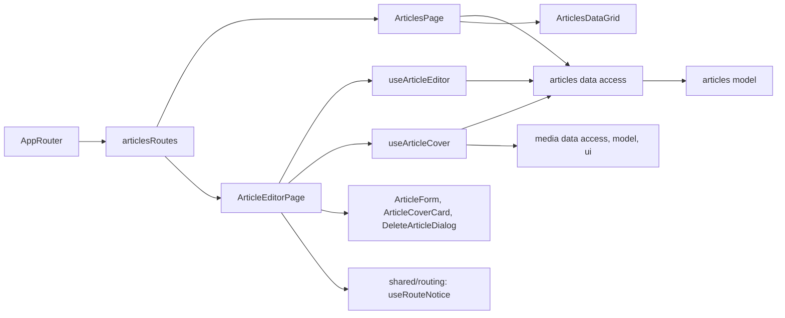

# Admin Articles

**Status:** implemented. Routes: `/articles`, `/articles/new`, `/articles/:articleId`. Backend: KedrStore Content module, contract [admin articles](../../contracts/openapi/content/articles.openapi.yaml); the public site reads the same articles ([site articles](../site/articles.md)).

- The [list](../../../libs/admin/articles/feature/src/pages/articles-page.tsx) shows covers, Ukrainian titles, addresses, and dates, newest first, with search over title and address. Only a draft gets a mark («Чернетка»); a published article needs none.
- The [editor](../../../libs/admin/articles/feature/src/pages/article-editor-page.tsx) is one form: address, publication date, and «Показувати на сайті», then «Українська» and «Русский» tabs with title, short description, and the shared [Tiptap editor](../../../libs/admin/shared/ui/src/lib/inputs/rich-text-editor/rich-text-editor.tsx). Both languages are required and saved together; a tab with errors is marked. A new article may leave the address empty: the server builds it from the Ukrainian title. A taken address comes back as a field error.
- The [cover card](../../../libs/admin/articles/ui/src/cover/article-cover-card.tsx) is there for a new article too: «Завантажити» sends a JPEG, PNG, or WebP (up to 10 MB, at least 600 px wide) at once to `POST /api/admin/articles/covers`, which stores a WebP up to 1600 px on the CDN (`articles/`) and in the media library folder «Статті»; «З медіатеки» picks any library picture with the shared [media picker](../../../libs/admin/media/ui/src/dialogs/media-picker-dialog.tsx). The choice is part of the draft and is saved with «Створити статтю» or «Зберегти» (`coverMediaFileId`, or `removeCover` after «Прибрати»). The six old articles keep their API-served covers until a new one is chosen. Server reasons are shown in Ukrainian; a missing CDN answers «Сховище фото недоступне».
- The list has a «Змінено» column and the editor a line under its heading: date, time and the email of the last editor (the shared [ChangedNote](../../../libs/admin/shared/ui/src/lib/feedback/changed-note.tsx)); articles saved before Content 007 show only the time.
- Deleting asks for confirmation and cannot be undone; to hide an article, turn publishing off.
- Every staff role (Manager and Admin) may manage articles, as the backend policy `CanManageContent`; the routes have no extra guard. Requests are in [articles data access](../../../libs/admin/articles/data-access/src/api/admin-articles.api.ts) with zod response checks.

## Architecture



## Code structure

```text
libs/admin/articles/
├── model/src/entities/article.ts            # article, summary, languages, limits
├── model/src/forms/article-draft.ts         # draft, new draft, comparison
├── model/src/validators/                    # draft rules, cover file rules
├── data-access/src/api/admin-articles.api.ts  # list, get, create, update, delete, cover upload
├── data-access/src/validators/              # zod response schemas
├── data-access/src/mappers/                 # response → model, CDN or legacy cover URL, save body
├── ui/src/tables/                           # list grid, columns, search toolbar
├── ui/src/forms/                            # article form, settings, one language
├── ui/src/cover/article-cover-card.tsx      # preview, upload, pick from the library, remove
├── ui/src/dialogs/delete-article-dialog.tsx # confirmation
└── feature/src/                             # routes, pages, hooks (draft, cover), errors
```

## Tests

- `npx nx run admin-articles-model:vite:test -- --run` — draft and cover rules.
- `npx nx run admin-articles-data-access:vite:test -- --run` — mapping and save body.
- `npx nx run admin-articles-ui:vite:test -- --run` — form tabs and buttons.
- `npx nx run admin-articles-feature:vite:test -- --run` — list, create checks, a new article with an uploaded cover, taken address, cover errors, delete.
