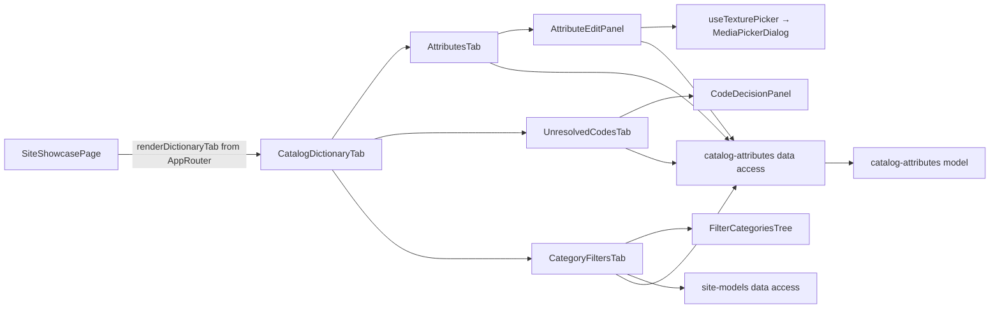

# Admin Catalog attributes («Ознаки»)

**Status:** implemented (phase 3 of the backend catalog attributes specification, KedrStore `docs/sdd/specs/catalog/006-*`; moved into «Вітрина сайту» by spec catalog/007 stage 4c). Tabs of [«Вітрина сайту»](site-models.md): «Ознаки» (`/site-showcase?tab=attributes`), «Не розшифровані коди» (`codes`), «Фільтри категорій» (`filters`); the old `/catalog-attributes` redirects there. Managers read; administrators and SEO specialists change. Composition rules: [Admin standard](../../standards/admin/list-detail-pages.md).

- The app passes [CatalogDictionaryTab](../../../libs/admin/catalog-attributes/feature/src/components/tabs/catalog-dictionary-tab.tsx) (loaded lazily) to the «Вітрина сайту» routes; «Нова ознака» sits beside the tabs and opens the panel of this tab.
- **Ознаки** (list + attribute, owner's variant Б 2026-11-06): [AttributeList](../../../libs/admin/catalog-attributes/ui/src/components/attributes/attribute-list.tsx) on the left groups attributes by role ([attributeRole](../../../libs/admin/catalog-attributes/model/src/mappers/attribute-role.ts): «Перемикачі моделей», «Фільтри каталогу», «Службові», «Не використовуються») with a search and product counts. On the right, [AttributeOverview](../../../libs/admin/catalog-attributes/ui/src/components/attributes/attribute-overview.tsx) shows the chosen attribute read-only: settings, every value with its swatch, code, 1C spellings («Не підтверджено» when a spelling is a guess), and products; codes without a value; problems only («Без товарів», «Не розшифровано кодів»). «Редагувати» (Admin, SEO), «Докладніше» (Manager), a value pencil, or «+ Значення» open the [attribute panel](../../../libs/admin/catalog-attributes/feature/src/components/panels/attribute-edit-panel.tsx) under the [right panel rule](../../standards/admin/list-detail-pages.md#editing-in-the-right-panel): names UK/RU, order, «Показувати як фільтр на сайті»; the [values](../../../libs/admin/catalog-attributes/ui/src/details/attribute-values-card.tsx) with a search from nine values, each changed in place with [AttributeValueForm](../../../libs/admin/catalog-attributes/ui/src/forms/attribute-value-form.tsx) (a `#RRGGBB` color; a picture of the finish uploaded from the computer to the CDN folder `swatches/`, library folder «Кольори», or picked from the [media library](media.md); or text only); and the 1C spellings, where only «Не розшифровано» and «Не підтверджено» are marked. A person's change is marked «Змінено вручну» and the dictionary import leaves it. An administrator adds an attribute of their own with «Нова ознака» in the [new attribute panel](../../../libs/admin/catalog-attributes/feature/src/components/panels/new-attribute-panel.tsx) ([fields](../../../libs/admin/catalog-attributes/ui/src/forms/new-attribute-fields.tsx)); the server makes its code and filter address from the name, and the new attribute's panel opens to add values. Type «Так / Ні» creates a list with the values «Так» and «Ні» at once.
- **Не розшифровані коди** (KedrStore spec catalog/008, 009): queue + code screen in [UnresolvedCodesTab](../../../libs/admin/catalog-attributes/feature/src/components/tabs/unresolved-codes-tab.tsx). Left, [CodeQueueList](../../../libs/admin/catalog-attributes/ui/src/components/codes/workspace/code-queue-list.tsx): code, attribute, on-site product count (↑/↓ move). Right, [CodeWorkspace](../../../libs/admin/catalog-attributes/ui/src/components/codes/workspace/code-workspace.tsx): «Не розшифровано» or the assistant's «Припущення», the products that contain the code grouped by category with the code highlighted in each 1C name (5 shown, «Показати всі N»). «Що означає код для всіх товарів»: «ознака → значення» rows in any attributes ([CodeMeaningsEditor](../../../libs/admin/catalog-attributes/ui/src/components/codes/meanings/code-meanings-editor.tsx), [CodeMeaningRow](../../../libs/admin/catalog-attributes/ui/src/components/codes/meanings/code-meaning-row.tsx) connected in [ConnectedCodeMeaningRow](../../../libs/admin/catalog-attributes/feature/src/components/tabs/connected-code-meaning-row.tsx)), «Ще ознака», «+ Нове значення…» adds a missing value to the chosen attribute, «Код нічого не означає». Per category: «Як для всіх», «Своя розшифровка» (its own rows) or «Нічого не означає». «Зберегти і далі» saves and opens the next code; «Пропустити» skips. Data: `getCodeProducts`, `decideAttributeCode` with `applyToAll`, `meanings` and `categories`.
- **Фільтри категорій:** the [tree](../../../libs/admin/catalog-attributes/ui/src/components/trees/filter-categories-tree.tsx) lists only categories shown on the site (the «Вітрина сайту» category tree) with each final category's filter count, and «без фільтрів» on a final category that has none; a final category opens [CategoryFiltersEditor](../../../libs/admin/catalog-attributes/ui/src/forms/category-filters-editor.tsx) with its full path: filters with product counts, reordered with arrows, each hidden or shown; «Зберегти» sends the whole list and refreshes the counts.
- Requests are in [catalog attributes data access](../../../libs/admin/catalog-attributes/data-access/src/api/catalog-attributes.api.ts) (tag `CatalogAttributes`); the category tree comes from [site models data access](../../../libs/admin/site-models/data-access/src/api/site-models.api.ts). Operations are in the [attributes contract](../../contracts/openapi/catalog/attributes.openapi.yaml).
- A product's own attributes and review are edited in the «Моделі» tab of [«Вітрина сайту»](site-models.md); the «Огляд» counts are in [dashboard](dashboard.md).

## Architecture



## Code structure

```text
libs/admin/catalog-attributes/
├── feature/src/index.ts                          # lazy CatalogDictionaryTab
├── feature/src/components/                       # dictionary tab, attributes, codes, filters tabs; panels
├── feature/src/hooks/use-texture-picker.ts       # media library picker for a decor texture
├── feature/src/errors/                           # Ukrainian error messages
├── data-access/src/api/catalog-attributes.api.ts # requests
├── data-access/src/{mappers,validators}/         # zod schemas, DTO → model
├── model/src/entities/                           # attribute, value, alias, unresolved code, category filter and tree
└── ui/src/                                       # tables, details cards, forms, panels, category tree, swatch
```

## Tests

- `npx nx run admin-catalog-attributes-model:vite:test -- --run` — color format, filter order, category tree and paths, decision notice.
- `npx nx run admin-catalog-attributes-data-access:vite:test -- --run` — value body.
- `npx nx run admin-catalog-attributes-ui:vite:test -- --run` — value form, codes grid, filters editor.
- `npx nx run admin-catalog-attributes-feature:vite:test -- --run` — panel save, Manager read-only, value edited in place, code decided in the panel, filters tree of shown categories.
