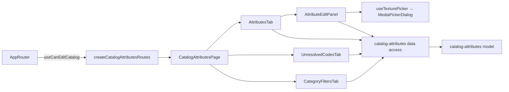

# Admin Catalog attributes («Властивості»)

**Status:** implemented (phase 3 of the backend catalog attributes specification, KedrStore `docs/sdd/specs/catalog/006-*`). Route: `/catalog-attributes`, menu «Каталог → Властивості». Managers read; administrators change. Composition rules: [Admin standard](../../standards/admin/list-detail-pages.md).

- The [page](../../../libs/admin/catalog-attributes/feature/src/pages/catalog-attributes-page.tsx) has three tabs kept in `?tab=`: «Властивості», «Не розшифровані коди» (`codes`), «Фільтри категорій» (`filters`).
- **Властивості:** [CatalogAttributesDataGrid](../../../libs/admin/catalog-attributes/ui/src/tables/catalog-attributes-data-grid.tsx) lists the dictionary (type, values, products, site filter). The pencil (Admin) or the eye (Manager) opens the [attribute panel](../../../libs/admin/catalog-attributes/feature/src/components/attribute-edit-panel.tsx) under the [right panel rule](../../standards/admin/list-detail-pages.md#editing-in-the-right-panel): names UK/RU, order, «Показувати як фільтр на сайті»; the values with a swatch (a `#RRGGBB` color, a decor texture picked from the [media library](media.md), or text only) in [AttributeValueDialog](../../../libs/admin/catalog-attributes/ui/src/dialogs/attribute-value-dialog.tsx); and the 1C spellings, where only «Не розшифровано» and «Не підтверджено» are marked. A person's change is marked «Змінено вручну» and the dictionary import leaves it.
- **Не розшифровані коди:** [UnresolvedCodesDataGrid](../../../libs/admin/catalog-attributes/ui/src/tables/unresolved-codes-data-grid.tsx), the most used first, with «Не розшифровано» or the assistant's «Припущення». An administrator picks the value or «Без значення» in [CodeDecisionDialog](../../../libs/admin/catalog-attributes/ui/src/dialogs/code-decision-dialog.tsx); the notice says how many product values were confirmed at once and that new decodings reach products with the next recognition.
- **Фільтри категорій:** pick a leaf category; [CategoryFiltersEditor](../../../libs/admin/catalog-attributes/ui/src/forms/category-filters-editor.tsx) shows its filters with product counts, reorders them with arrows and hides or shows each; «Зберегти» sends the whole list.
- Edit rights come from `useCanEditCatalog` (Admin role) through `createCatalogAttributesRoutes`. Requests are in [catalog attributes data access](../../../libs/admin/catalog-attributes/data-access/src/api/catalog-attributes.api.ts) (tag `CatalogAttributes`); operations are in the [attributes contract](../../contracts/openapi/catalog/attributes.openapi.yaml).
- The product side (problem labels, «Група», panel sections «Властивості», «Група», «Перевірка») is in [products](products.md); the «Огляд» counts are in [dashboard](dashboard.md).

## Architecture



## Code structure

```text
libs/admin/catalog-attributes/
├── feature/src/catalog-attributes.routes.tsx     # route; edit rights from the app
├── feature/src/pages/catalog-attributes-page.tsx # tabs in ?tab=
├── feature/src/components/                       # attributes, codes, category filters tabs; attribute panel
├── feature/src/hooks/use-texture-picker.ts       # media library picker for a decor texture
├── feature/src/errors/                           # Ukrainian error messages
├── data-access/src/api/catalog-attributes.api.ts # requests
├── data-access/src/{mappers,validators}/         # zod schemas, DTO → model, leaf categories with path
├── model/src/entities/                           # attribute, value, alias, unresolved code, category filter
└── ui/src/                                       # tables, details cards, dialogs, filters editor, swatch
```

## Tests

- `npx nx run admin-catalog-attributes-model:vite:test -- --run` — color format, filter order, decision notice.
- `npx nx run admin-catalog-attributes-data-access:vite:test -- --run` — leaf categories, value body.
- `npx nx run admin-catalog-attributes-ui:vite:test -- --run` — value dialog, codes grid, filters editor.
- `npx nx run admin-catalog-attributes-feature:vite:test -- --run` — panel save, Manager read-only, tab from the address.
