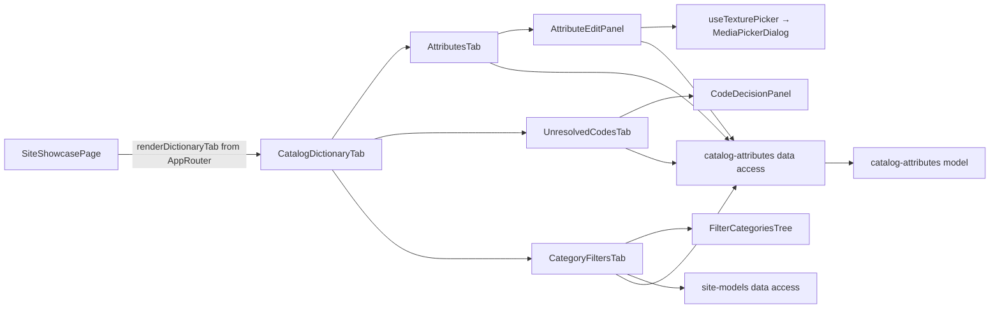

# Admin Catalog attributes («Ознаки»)

**Status:** implemented (phase 3 of the backend catalog attributes specification, KedrStore `docs/sdd/specs/catalog/006-*`; moved into «Вітрина сайту» by spec catalog/007 stage 4c). Tabs of [«Вітрина сайту»](site-models.md): «Ознаки» (`/site-showcase?tab=attributes`), «Не розшифровані коди» (`codes`), «Фільтри категорій» (`filters`); the old `/catalog-attributes` redirects there. Managers read; administrators and SEO specialists change. Composition rules: [Admin standard](../../standards/admin/list-detail-pages.md).

- The app passes [CatalogDictionaryTab](../../../libs/admin/catalog-attributes/feature/src/components/catalog-dictionary-tab.tsx) (loaded lazily) to the «Вітрина сайту» routes; «Нова ознака» sits beside the tabs and opens the panel of this tab.
- **Ознаки:** [CatalogAttributesDataGrid](../../../libs/admin/catalog-attributes/ui/src/tables/catalog-attributes-data-grid.tsx) lists the dictionary (type, values, products, site filter). The pencil (Admin, SEO) or the eye (Manager) opens the [attribute panel](../../../libs/admin/catalog-attributes/feature/src/components/attribute-edit-panel.tsx) under the [right panel rule](../../standards/admin/list-detail-pages.md#editing-in-the-right-panel): names UK/RU, order, «Показувати як фільтр на сайті»; the [values](../../../libs/admin/catalog-attributes/ui/src/details/attribute-values-card.tsx) with a search from nine values, each changed in place with [AttributeValueForm](../../../libs/admin/catalog-attributes/ui/src/forms/attribute-value-form.tsx) (a `#RRGGBB` color, a decor texture picked from the [media library](media.md), or text only); and the 1C spellings, where only «Не розшифровано» and «Не підтверджено» are marked. A person's change is marked «Змінено вручну» and the dictionary import leaves it. An administrator adds an attribute of their own with «Нова ознака» in the [new attribute panel](../../../libs/admin/catalog-attributes/feature/src/components/new-attribute-panel.tsx) ([fields](../../../libs/admin/catalog-attributes/ui/src/forms/new-attribute-fields.tsx)); the server makes its code and filter address from the name, and the new attribute's panel opens to add values.
- **Не розшифровані коди:** [UnresolvedCodesDataGrid](../../../libs/admin/catalog-attributes/ui/src/tables/unresolved-codes-data-grid.tsx), the most used first, with «Не розшифровано» or the assistant's «Припущення». An administrator decides in the right-side [CodeDecisionPanel](../../../libs/admin/catalog-attributes/ui/src/panels/code-decision-panel.tsx): a searchable list of values with swatches, or «Це не …: не використовувати у фільтрах», saved with «Зберегти для N тов.»; the notice says how many product values were confirmed at once.
- **Фільтри категорій:** the [tree](../../../libs/admin/catalog-attributes/ui/src/trees/filter-categories-tree.tsx) lists only categories shown on the site (the «Вітрина сайту» category tree) with each final category's filter count, and «без фільтрів» on a final category that has none; a final category opens [CategoryFiltersEditor](../../../libs/admin/catalog-attributes/ui/src/forms/category-filters-editor.tsx) with its full path: filters with product counts, reordered with arrows, each hidden or shown; «Зберегти» sends the whole list and refreshes the counts.
- Requests are in [catalog attributes data access](../../../libs/admin/catalog-attributes/data-access/src/api/catalog-attributes.api.ts) (tag `CatalogAttributes`); the category tree comes from [site models data access](../../../libs/admin/site-models/data-access/src/api/site-models.api.ts). Operations are in the [attributes contract](../../contracts/openapi/catalog/attributes.openapi.yaml).
- A product's own attributes and review are edited in the «Моделі» tab of [«Вітрина сайту»](site-models.md); the «Огляд» counts are in [dashboard](dashboard.md).

## Architecture



## Code structure

```text
libs/admin/catalog-attributes/
├── feature/src/index.ts                          # lazy CatalogDictionaryTab
├── feature/src/components/                       # dictionary tab, attributes, codes, filters tabs; panels
├── feature/src/hooks/use-texture-picker.ts       # media library picker for a decor texture
├── feature/src/errors/                           # Ukrainian error messages
├── data-access/src/api/catalog-attributes.api.ts # requests
├── data-access/src/{mappers,validators}/         # zod schemas, DTO → model
├── model/src/entities/                           # attribute, value, alias, unresolved code, category filter and tree
└── ui/src/                                       # tables, details cards, forms, panels, category tree, swatch
```

## Tests

- `npx nx run admin-catalog-attributes-model:vite:test -- --run` — color format, filter order, category tree and paths, decision notice.
- `npx nx run admin-catalog-attributes-data-access:vite:test -- --run` — value body.
- `npx nx run admin-catalog-attributes-ui:vite:test -- --run` — value form, codes grid, filters editor.
- `npx nx run admin-catalog-attributes-feature:vite:test -- --run` — panel save, Manager read-only, value edited in place, code decided in the panel, filters tree of shown categories.
