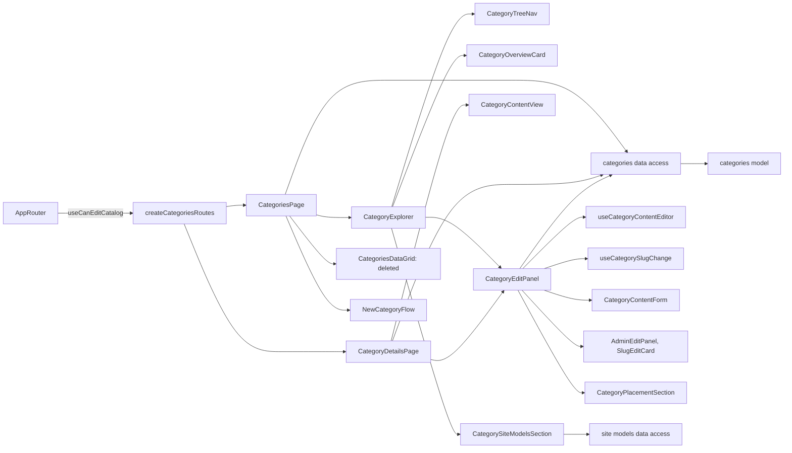

# Admin Categories

**Status:** implemented. Routes: `/categories` and `/categories/:categoryId`. Requirements and checks: [categories SDD](../../specs/admin/categories/001-slugs-seo-content/README.md), [managing the tree by hand](../../specs/admin/categories/002-manual-categories/README.md); composition rules: [Admin standard](../../standards/admin/list-detail-pages.md).

- The [list](../../../libs/admin/categories/feature/src/pages/categories-page.tsx) is the «Провідник» layout chosen by the product owner on 2026-11-04 ([audit and variants](https://claude.ai/artifact/HTLt4b6SiKZU7JmcMnAkPC), variant B). On the left, [CategoryTreeNav](../../../libs/admin/categories/ui/src/components/category-tree-nav.tsx) shows the whole 1C tree (MUI X `SimpleTreeView`, no pages) with product counts (with subcategories) and a red dot with «Немає тексту», «Немає UK» or «Немає RU» where a language has no site text; the «Без тексту · N» chip keeps only those categories with their parents; it collapses and expands, and search by Ukrainian or Russian name or address keeps the found rows with their parents. On the right, [CategoryOverviewCard](../../../libs/admin/categories/ui/src/details/category-overview-card.tsx) shows the selected category read-only: path, names, address, a summary of the texts per language (only an empty language is marked «Немає тексту»), and subcategory chips. The selection is in `?category=`; on phones the card is under the tree. A category hidden from the site is greyed in the tree with a crossed-out eye; the card says «Показується на сайті» or marks «Не показується на сайті». Administrators get «Сховати з сайту» / «Показати на сайті» on the card: a [confirmation](../../../libs/admin/categories/ui/src/dialogs/category-site-visibility-dialog.tsx) names how many subcategories follow (hiding takes them all; showing also shows the parents), then `PUT /api/categories/{id}/site-visibility` refreshes categories and the site models lists. Administrators also get «Редагувати» on the card and the «Видалені» tab (`?tab=deleted`) with categories the 1C import soft-deleted.
- [Details](../../../libs/admin/categories/feature/src/pages/category-details-page.tsx) are read-only: names, 1C key, path, the public address `/uk/catalog/{slug}`, and the site texts. Administrators get «Редагувати», which opens the same panel.
- The [edit panel](../../../libs/admin/categories/feature/src/components/panels/category-edit-panel.tsx) follows the [right panel rule](../../standards/admin/list-detail-pages.md#editing-in-the-right-panel): the address (`SlugEditCard`, typed or «Згенерувати з назви»; the old address keeps redirecting) and the [content section](../../../libs/admin/categories/feature/src/components/panels/category-content-section.tsx) with «Українська» and «Русский» tabs: SEO title, meta description, H1 with counters, a [Tiptap text editor](../../../libs/admin/shared/ui/src/lib/inputs/rich-text-editor/rich-text-editor.tsx) limited to the tags the server keeps, and an FAQ list. Each language saves separately; unsaved text survives a tab switch and closing the panel. The same section without an editor is the read-only view. Below it, the [search section](../../../libs/admin/categories/feature/src/components/panels/category-search-section.tsx) ([SEO stage 2](../../specs/site/migration/seo-stage-2-2026-11-26/README.md)) has two cards: «Назва на сайті» (Ukrainian and Russian names that win over 1C on the site; an empty field returns to the 1C name; `PUT /api/categories/{id}/site-names`) and «Пошук і поширення» (the «Закрити від пошуку» switch, which closes the category and its subcategories, and a link-preview picture from the media library; `PUT /api/categories/{id}/search-settings`). A closed category is marked «Закрито від пошуку» next to its site visibility.
- **Managing the tree by hand** ([spec 002](../../specs/admin/categories/002-manual-categories/README.md)): editors get «Нова категорія» in the header ([flow](../../../libs/admin/categories/feature/src/components/placement/new-category-flow.tsx)): uk/ru names, «Вкласти в» (preset to the selected category), «Показувати на сайті». The edit panel of every category has «Розташування» ([section](../../../libs/admin/categories/feature/src/components/placement/category-placement-section.tsx)): a new parent and «Вище» / «Нижче»; a manual category, marked «Створена вручну», also has «Видалити» while it is empty. A final category shows «Моделі на сайті» under its overview, with «Додати моделі» ([section](../../../libs/admin/categories/feature/src/components/explorer/category-site-models-section.tsx)). What is set here wins over 1C, and the admin never says where 1C keeps a category.
- Who may edit comes from `useCanEditCatalog` (Admin or Seo role), which AppRouter passes to the route factory. Requests are in [categories data access](../../../libs/admin/categories/data-access/src/api/admin-categories.api.ts); operations are in the [categories contract](../../contracts/catalog/admin-categories.md).

## Architecture



## Code structure

```text
libs/admin/categories/
├── feature/src/categories.routes.tsx                   # routes; edit rights from the app
├── feature/src/pages/                                  # list and details pages
├── feature/src/components/explorer/                    # tree + selected category (?category=), «Моделі на сайті»
├── feature/src/components/panels/                      # right edit panel, language tabs, site names and search
├── feature/src/components/placement/                   # «Нова категорія», «Розташування» and «Видалити»
├── feature/src/hooks/editing/, tree/, placement/        # content and slug; tree view and visibility; create, move, delete, models
├── data-access/src/api/                                # category requests; create, move, order, delete, add models
├── data-access/src/mappers/                            # rows, content, save body
├── model/src/                                          # entities, validators (content limits), mappers (tree order, nodes, search)
└── ui/src/                                             # tree, details, tables (deleted), forms (content, FAQ, site names, search, place), panels (new, add models), dialogs

libs/admin/shared/ui/src/lib/layout/admin-edit-panel.tsx  # shared right edit panel
libs/admin/shared/ui/src/lib/slug/                      # SlugEditCard, slug rule, PublicAddressCard
libs/admin/shared/ui/src/lib/inputs/                    # CountedTextField, RichTextEditor (also used by articles)
libs/admin/media/data-access/src/api/use-media-picker.ts # picker state for the share picture
```

## Tests

- `libs/admin/categories/model` (5 spec files): `npx nx run admin-categories-model:vite:test -- --run`
- `libs/admin/categories/data-access` (2 spec files): `npx nx run admin-categories-data-access:vite:test -- --run`
- `libs/admin/categories/ui` (5 spec files): `npx nx run admin-categories-ui:vite:test -- --run`
- `libs/admin/categories/feature` (7 spec files): `npx nx run admin-categories-feature:vite:test -- --run`
- `libs/admin/shared/ui` (slug card, edit panel): `npx nx run admin-shared-ui:vite:test -- --run`
