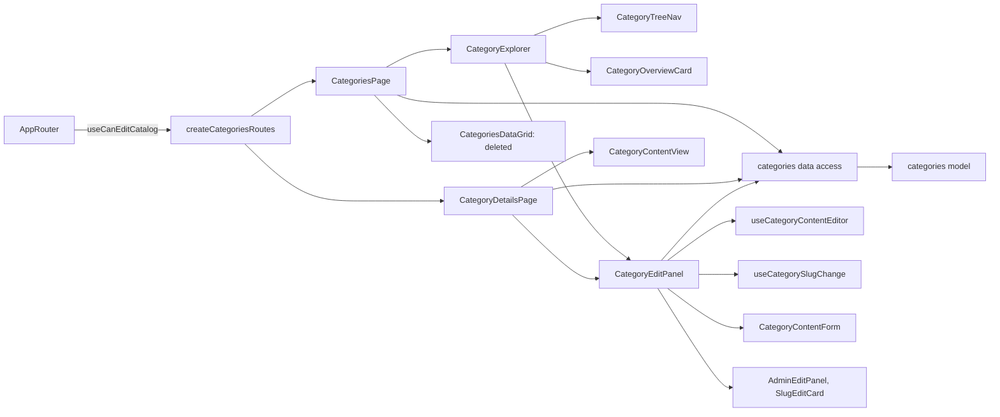

# Admin Categories

**Status:** implemented. Routes: `/categories` and `/categories/:categoryId`. Requirements and checks: [categories SDD](../../specs/admin/categories/001-slugs-seo-content/README.md); composition rules: [Admin standard](../../standards/admin/list-detail-pages.md).

- The [list](../../../libs/admin/categories/feature/src/pages/categories-page.tsx) is the «Провідник» layout chosen by the product owner on 2026-11-04 ([audit and variants](https://claude.ai/artifact/HTLt4b6SiKZU7JmcMnAkPC), variant B). On the left, [CategoryTreeNav](../../../libs/admin/categories/ui/src/navigation/category-tree-nav.tsx) shows the whole 1C tree (MUI X `SimpleTreeView`, no pages) with product counts (with subcategories) and a red dot with «Немає тексту», «Немає UK» or «Немає RU» where a language has no site text; the «Без тексту · N» chip keeps only those categories with their parents; it collapses and expands, and search by Ukrainian or Russian name or address keeps the found rows with their parents. On the right, [CategoryOverviewCard](../../../libs/admin/categories/ui/src/details/category-overview-card.tsx) shows the selected category read-only: path, names, address, a summary of the texts per language (only an empty language is marked «Немає тексту»), and subcategory chips. The selection is in `?category=`; on phones the card is under the tree. A category hidden from the site is greyed in the tree with a crossed-out eye; the card says «Показується на сайті» or marks «Не показується на сайті». Administrators get «Сховати з сайту» / «Показати на сайті» on the card: a [confirmation](../../../libs/admin/categories/ui/src/dialogs/category-site-visibility-dialog.tsx) names how many subcategories follow (hiding takes them all; showing also shows the parents), then `PUT /api/categories/{id}/site-visibility` refreshes categories and the site models lists. Administrators also get «Редагувати» on the card and the «Видалені» tab (`?tab=deleted`) with categories the 1C import soft-deleted.
- [Details](../../../libs/admin/categories/feature/src/pages/category-details-page.tsx) are read-only: names, 1C key, path, the public address `/uk/catalog/{slug}`, and the site texts. Administrators get «Редагувати», which opens the same panel.
- The [edit panel](../../../libs/admin/categories/feature/src/components/category-edit-panel.tsx) follows the [right panel rule](../../standards/admin/list-detail-pages.md#editing-in-the-right-panel): the address (`SlugEditCard`, typed or «Згенерувати з назви»; the old address keeps redirecting) and the [content section](../../../libs/admin/categories/feature/src/components/category-content-section.tsx) with «Українська» and «Русский» tabs: SEO title, meta description, H1 with counters, a [Tiptap text editor](../../../libs/admin/shared/ui/src/lib/inputs/rich-text-editor/rich-text-editor.tsx) limited to the tags the server keeps, and an FAQ list. Each language saves separately; unsaved text survives a tab switch and closing the panel. The same section without an editor is the read-only view.
- Who may edit comes from `useCanEditCatalog` (Admin role), which AppRouter passes to the route factory. Requests are in [categories data access](../../../libs/admin/categories/data-access/src/api/admin-categories.api.ts); operations are in the [categories contract](../../contracts/catalog/admin-categories.md).

## Architecture



## Code structure

```text
libs/admin/categories/
├── feature/src/categories.routes.tsx                   # routes; edit rights from the app
├── feature/src/pages/                                  # list and details pages
├── feature/src/components/category-explorer.tsx        # tree + selected category, ?category= state
├── feature/src/components/category-edit-panel.tsx      # right edit panel: address and texts
├── feature/src/components/category-content-section.tsx # language tabs, form or read-only
├── feature/src/hooks/                                  # content drafts and save, slug change
├── data-access/src/api/admin-categories.api.ts         # category requests
├── data-access/src/mappers/                            # rows, content, save body
├── model/src/                                          # entities, validators (content limits), mappers (tree order, nodes, search)
└── ui/src/                                             # navigation (tree), details (overview), tables (deleted), forms/category-content (FAQ)

libs/admin/shared/ui/src/lib/layout/admin-edit-panel.tsx  # shared right edit panel
libs/admin/shared/ui/src/lib/slug/                      # SlugEditCard, slug rule, PublicAddressCard
libs/admin/shared/ui/src/lib/inputs/                    # CountedTextField, RichTextEditor (also used by articles)
```

## Tests

- `libs/admin/categories/model` (3 spec files): `npx nx run admin-categories-model:vite:test -- --run`
- `libs/admin/categories/data-access` (1 spec file): `npx nx run admin-categories-data-access:vite:test -- --run`
- `libs/admin/categories/ui` (2 spec files): `npx nx run admin-categories-ui:vite:test -- --run`
- `libs/admin/categories/feature` (1 spec file): `npx nx run admin-categories-feature:vite:test -- --run`
- `libs/admin/shared/ui` (slug card, edit panel): `npx nx run admin-shared-ui:vite:test -- --run`
