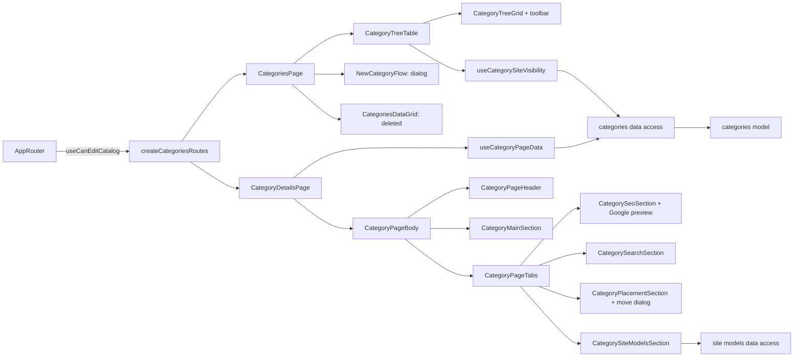

# Admin Categories

**Status:** implemented. Routes: `/categories` and `/categories/:categoryId`. Requirements and checks: [categories SDD](../../specs/admin/categories/001-slugs-seo-content/README.md), [managing the tree by hand](../../specs/admin/categories/002-manual-categories/README.md), [table and page](../../specs/admin/categories/003-category-table-and-page/README.md); composition rules: [Admin standard](../../standards/admin/list-detail-pages.md).

- **Layout** ([spec 003](../../specs/admin/categories/003-category-table-and-page/README.md), concept A chosen by the product owner on 2026-11-26, [concepts](https://claude.ai/artifact/QWGaMKrNcnfkURfEJodNW5)): a tree table for the list and a category page with blocks and tabs. Categories have **no right edit panel**: everything is edited on the category page, and «Нова категорія», «Перемістити» and «Додати моделі» are dialogs (owner's exception to the [right panel rule](../../standards/admin/list-detail-pages.md#editing-in-the-right-panel)).
- The [list](../../../libs/admin/categories/feature/src/pages/categories-page.tsx) is one [tree table](../../../libs/admin/categories/ui/src/tables/tree/category-tree-grid.tsx) (MUI X DataGrid, pages of 100): an arrow opens subcategories (top level open at start, «Розгорнути все»/«Згорнути все»), then «Назва на сайті» (site name, else the Ukrainian name, with «Створена вручну»), «Повний шлях», «Назва в 1С», ID, the «На сайті» switch, «Товарів» and «Моделей» (with subcategories), «Чого бракує» (no text, no text in one language, no models in a final category, unchecked models) and a link to the page. Search finds Ukrainian, Russian and site names, the 1C name, the address and an exact ID and keeps parents; chips filter «Без тексту», «Сховані», «Закриті від пошуку», «Створені вручну». A click on the row opens the category page. For administrators the switch asks a [confirmation](../../../libs/admin/categories/ui/src/dialogs/category-site-visibility-dialog.tsx) that names how many subcategories follow (hiding takes them all; showing also shows the parents), then `PUT /api/categories/{id}/site-visibility`. Administrators also get the «Видалені» tab (`?tab=deleted`) with categories the 1C import soft-deleted.
- The [category page](../../../libs/admin/categories/feature/src/pages/category-details-page.tsx) has a [header](../../../libs/admin/categories/feature/src/components/page/category-page-header.tsx) with the path as links, the site name, «Створена вручну», «Сховано з сайту» / «Закрито від пошуку», and «Відкрити на сайті», «Перемістити», «Сховати з сайту» / «Показати на сайті» and «Видалити» (empty manual category). Below: «Основне» (site and 1C names, ID, address, counts; «Редагувати» turns it into the site names form and the address `SlugEditForm`, the old address keeps redirecting), «Що бракує» (each problem opens its tab), and [tabs](../../../libs/admin/categories/feature/src/components/page/category-page-tabs.tsx) in `?tab=`: «Моделі · N» (final category, «Додати моделі») or «Підкатегорії · N», «SEO» (Ukrainian and Russian side by side with a [«Як у Google»](../../../libs/admin/categories/ui/src/details/sections/category-google-preview.tsx) preview; each language is edited and saved separately: SEO title, meta description, H1, a [Tiptap text editor](../../../libs/admin/shared/ui/src/lib/inputs/rich-text-editor/rich-text-editor.tsx) and FAQ), «Пошук і поширення» (the «Закрити від пошуку» switch, which closes the category and its subcategories, and a link-preview picture from the media library; `PUT /api/categories/{id}/search-settings`) and «Розташування» (parent and order «Вище» / «Нижче»). The by-id read has no counts, so the page takes them from the list row.
- **Managing the tree by hand** ([spec 002](../../specs/admin/categories/002-manual-categories/README.md)): editors get «Нова категорія» on the list ([dialog](../../../libs/admin/categories/ui/src/dialogs/category-new-dialog.tsx)): uk/ru names, «Вкласти в», «Показувати на сайті»; after creating, the new page opens. What is set here wins over 1C, and the admin never says where 1C keeps a category.
- Who may edit comes from `useCanEditCatalog` (Admin or Seo role), which AppRouter passes to the route factory. Requests are in [categories data access](../../../libs/admin/categories/data-access/src/api/admin-categories.api.ts); operations are in the [categories contract](../../contracts/catalog/admin-categories.md).

## Architecture



## Code structure

```text
libs/admin/categories/
├── feature/src/categories.routes.tsx                   # routes; edit rights from the app
├── feature/src/pages/                                  # list and category page
├── feature/src/components/list/                        # tree table with the row switch, «Нова категорія»
├── feature/src/components/page/                        # page header, tabs, body (move, visibility, delete)
├── feature/src/components/sections/                    # «Основне», SEO, search, placement, models
├── feature/src/hooks/editing/, page/, tree/, placement/ # content, slug, names, search; page data; table view, visibility; create, move, delete, models
├── data-access/src/api/                                # category requests; create, move, order, delete, add models
├── data-access/src/mappers/                            # rows (with model counts), content, save body
├── model/src/mappers/tree/                             # tree order, rows, filters and search
├── model/src/mappers/page/                             # placement, «Що бракує», Google preview
└── ui/src/                                             # tables (tree, deleted), details (main, sections), forms, dialogs (new, move, add models, visibility, delete)

libs/admin/shared/ui/src/lib/slug/                      # SlugEditForm, SlugEditCard, slug rule, PublicAddressCard
libs/admin/shared/ui/src/lib/inputs/                    # CountedTextField, RichTextEditor (also used by articles)
libs/admin/media/data-access/src/api/use-media-picker.ts # picker state for the share picture
```

## Tests

- `libs/admin/categories/model` (9 spec files): `npx nx run admin-categories-model:vite:test -- --run`
- `libs/admin/categories/data-access` (2 spec files): `npx nx run admin-categories-data-access:vite:test -- --run`
- `libs/admin/categories/ui` (8 spec files): `npx nx run admin-categories-ui:vite:test -- --run`
- `libs/admin/categories/feature` (9 spec files): `npx nx run admin-categories-feature:vite:test -- --run`
- `libs/admin/shared/ui` (slug form and card): `npx nx run admin-shared-ui:vite:test -- --run`
