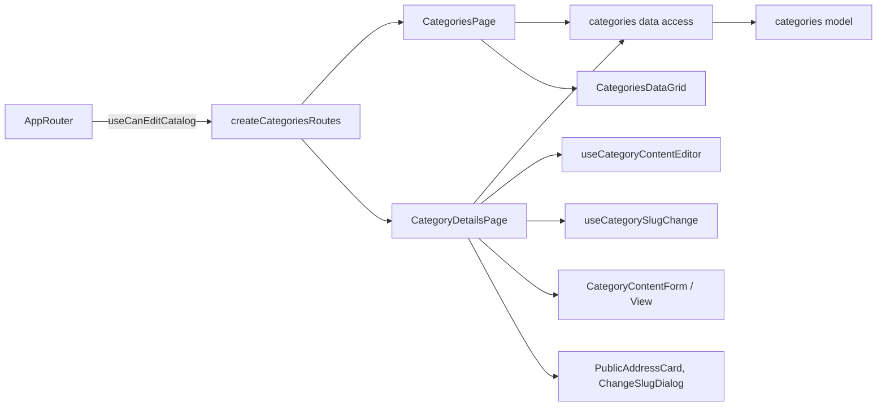

# Admin Categories

**Status:** implemented. Routes: `/categories` and `/categories/:categoryId`. Requirements and checks: [categories SDD](../../specs/admin/categories/001-slugs-seo-content/README.md); composition rules: [Admin standard](../../standards/admin/list-detail-pages.md).

- The [list](../../../libs/admin/categories/feature/src/pages/categories-page.tsx) shows the 1C category tree in display order with search over name and address. Administrators also get the «Видалені» tab (`?tab=deleted`) with categories the 1C import soft-deleted.
- [Details](../../../libs/admin/categories/feature/src/pages/category-details-page.tsx) show names, 1C key, path, and the public address `/uk/catalog/{slug}`. Administrators change the address in a dialog (typed or «Згенерувати з назви»); the old address keeps redirecting.
- The [content section](../../../libs/admin/categories/feature/src/components/category-content-section.tsx) has «Українська» and «Русский» tabs: SEO title, meta description, H1 with counters, a [Tiptap text editor](../../../libs/admin/categories/ui/src/components/rich-text-editor/rich-text-editor.tsx) limited to the tags the server keeps, and an FAQ list. Each language saves separately; unsaved text survives a tab switch. Managers see the same content read-only.
- Who may edit comes from `useCanEditCatalog` (Admin role), which AppRouter passes to the route factory. Requests are in [categories data access](../../../libs/admin/categories/data-access/src/api/admin-categories.api.ts); operations are in the [categories contract](../../contracts/catalog/admin-categories.md).

## Architecture



## Code structure

```text
libs/admin/categories/
├── feature/src/categories.routes.tsx                   # routes; edit rights from the app
├── feature/src/pages/                                  # list and details pages
├── feature/src/components/category-content-section.tsx # language tabs
├── feature/src/hooks/                                  # content drafts and save, slug change
├── data-access/src/api/admin-categories.api.ts         # category requests
├── data-access/src/mappers/                            # rows, content, save body
├── model/src/                                          # entities, validators (content limits), mappers (tree order)
└── ui/src/                                             # tables, details, forms/category-content (FAQ), components/rich-text-editor

libs/admin/shared/ui/src/lib/slug/                      # ChangeSlugDialog, slug rule, PublicAddressCard
```

## Tests

- `libs/admin/categories/model` (2 spec files): `npx nx run admin-categories-model:vite:test -- --run`
- `libs/admin/categories/data-access` (1 spec file): `npx nx run admin-categories-data-access:vite:test -- --run`
- `libs/admin/categories/ui` (2 spec files): `npx nx run admin-categories-ui:vite:test -- --run`
- `libs/admin/categories/feature` (1 spec file): `npx nx run admin-categories-feature:vite:test -- --run`
- `libs/admin/shared/ui` (slug dialog): `npx nx run admin-shared-ui:vite:test -- --run`
