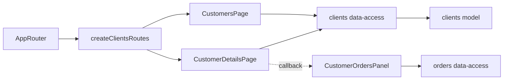

# Клієнти Admin

**Стан:** реалізовано. Маршрути: `/customers` і `/customers/:counterpartyId`. Вимоги та перевірки: [SDD перегляду](../../specs/admin/clients/001-read-only-customers/README.md) і [SDD замовлень клієнта](../../specs/admin/clients/002-customer-orders/README.md).

- [Список](../../../libs/admin/clients/feature/src/pages/customers-page.tsx) читає активних клієнтів через [clients data-access](../../../libs/admin/clients/data-access/src/api/admin-customers.api.ts). Пошук, сортування та пагінація виконуються сервером; стан списку зберігається в URL.
- [Деталі](../../../libs/admin/clients/feature/src/pages/customer-details-page.tsx) показують основні, контактні й цінові дані. Під ними [панель замовлень](../../../libs/admin/orders/feature/src/orders.routes.tsx) запитує замовлення та чернетки з точним фільтром `counterpartyId`. App router передає панель через callback, тому clients feature не залежить від orders feature.
- Дані та допустимі параметри описує [consumer contract](../../contracts/sales/admin-customers.md); композицію списку, деталей і повернення — [Admin standard](../../standards/admin/list-detail-pages.md). Поведінку панелі замовлень описує [окрема фіча](orders.md).

## Схема будови



## Структура в коді

```text
libs/admin/clients/
├── feature/src/clients.routes.tsx                  # маршрути й межа callback
├── feature/src/pages/customers-page.tsx           # список і URL-стан
├── feature/src/pages/customer-details-page.tsx    # деталі та місце панелі замовлень
├── data-access/src/api/admin-customers.api.ts     # запити list/detail
├── data-access/src/mappers/customer.mapper.ts     # перевірка відповіді
├── model/src/queries/customer-page-params.ts      # параметри списку
└── ui/src/                                       # таблиця й картки без HTTP
```
