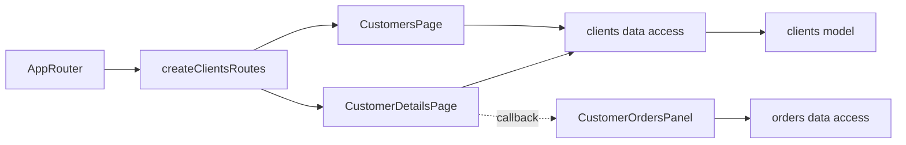

# Admin Clients

**Status:** implemented. Routes: `/customers` and `/customers/:counterpartyId`. Requirements and checks: [read-only view SDD](../../specs/admin/clients/001-read-only-customers/README.md) and [customer orders SDD](../../specs/admin/clients/002-customer-orders/README.md).

- The [list](../../../libs/admin/clients/feature/src/pages/customers-page.tsx) reads active customers through [clients data access](../../../libs/admin/clients/data-access/src/api/admin-customers.api.ts). Search, sorting, and pagination run on the server; list state is stored in the URL.
- [Details](../../../libs/admin/clients/feature/src/pages/customer-details-page.tsx) show basic, contact, and pricing data. Below them, the [orders panel](../../../libs/admin/orders/feature/src/orders.routes.tsx) queries orders and drafts with the exact `counterpartyId` filter. The app router passes the panel through a callback, so the clients feature does not depend on the orders feature.
- The [consumer contract](../../contracts/sales/admin-customers.md) describes data and allowed parameters; the [Admin standard](../../standards/admin/list-detail-pages.md) describes list/detail composition and return navigation. See the [separate feature](orders.md) for orders panel behavior.

## Architecture



## Code structure

```text
libs/admin/clients/
├── feature/src/clients.routes.tsx                  # routes and callback boundary
├── feature/src/pages/customers-page.tsx           # list and URL state
├── feature/src/pages/customer-details-page.tsx    # details and orders panel placement
├── data-access/src/api/admin-customers.api.ts     # list/detail requests
├── data-access/src/mappers/customer.mapper.ts     # response validation
├── model/src/queries/customer-page-params.ts      # list parameters
└── ui/src/                                       # table and cards without HTTP

libs/admin/shared/ui/src/                         # grid overlay, page header
```

## Tests

Spec files sit next to the code in each project. Focused runs:

- `libs/admin/clients/data-access` (1 spec files): `npx nx run admin-clients-data-access:vite:test -- --run`
- `libs/admin/clients/feature` (2 spec files): `npx nx run admin-clients-feature:vite:test -- --run`
- `libs/admin/clients/model` (1 spec files): `npx nx run admin-clients-model:vite:test -- --run`
- `libs/admin/clients/ui` (2 spec files): `npx nx run admin-clients-ui:vite:test -- --run`
- `libs/admin/orders/feature` (5 spec files): `npx nx run admin-orders-feature:vite:test -- --run`
- `libs/admin/shared/ui` (5 spec files): `npx nx run admin-shared-ui:vite:test -- --run`
