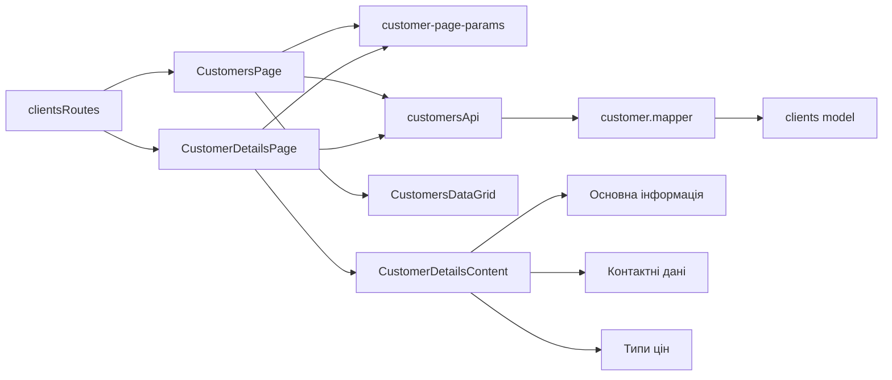

# Перегляд клієнтів Admin

**Стан:** реалізовані список `/customers` і read-only картка `/customers/:counterpartyId` за [SDD](../../specs/admin/clients/001-read-only-customers/README.md).

- **Вхід:** [clientsRoutes](../../../libs/admin/clients/feature/src/clients.routes.tsx) підключено в Admin router; меню містить пункт «Клієнти».
- **Список:** [CustomersPage](../../../libs/admin/clients/feature/src/pages/customers-page.tsx) показує активних клієнтів у [MUI Data Grid](../../../libs/admin/clients/ui/src/tables/customers-data-grid.tsx). Одне постійно видиме поле пошуку в toolbar таблиці має іконку лупи ліворуч усередині поля та шукає на сервері за ID, ім'ям і телефоном у всій вибірці; окремої форми й кнопки «Знайти» немає. Фільтри колонок вимкнені. Заголовки «Клієнт», «Телефон» та «ID» керують серверним сортуванням за зростанням або спаданням; типовий порядок — за іменем. Пошук, сортування й серверна пагінація передаються в API; сервер рахує загальну кількість після пошуку й до пагінації. Номер і розмір сторінки, пошук та сортування зберігаються в URL для повернення з деталей. Зміна сортування повертає на першу сторінку. На телефоні й планшеті колонки та іконка перегляду з підказкою доступні через горизонтальне прокручування.
- **Деталі:** [CustomerDetailsPage](../../../libs/admin/clients/feature/src/pages/customer-details-page.tsx) має нейтральний заголовок «Деталі клієнта» і [спільний формат сторінок](../../standards/admin/list-detail-pages.md) із посиланням повернення зі стрілкою. Три картки показують ім'я з ID, контактні дані й типи цін без таблиць. Тип цін за замовчуванням і типи цін за категоріями мають назви; категорія має назву та ID. Якщо backend не має назви, видно «Назва недоступна», а числовий ID типу цін не використовується як підпис. Довгі значення переносяться на вузькому екрані. Картки використовують світлу й темну схеми чинної Admin theme. Основна інформація займає всю ширину; від `md` контакти й типи цін стоять під нею в одному ряду, усі три картки однакової висоти. До `md` картки йдуть одна під одною з висотою за вмістом. Пряме посилання, 404, помилка, повтор запиту й повернення до списку мають окрему поведінку.
- **Дані:** [clients data-access](../../../libs/admin/clients/data-access/src/api/admin-customers.api.ts) виконує RTK Query list/detail і мапить перевірену відповідь у [модель](../../../libs/admin/clients/model/src/entities/customer.ts). [Consumer contract](../../contracts/sales/admin-customers.md) описує чинний snapshot і параметри API; ширші серверні фільтри лишаються в контракті, але цей екран їх не показує.
- **Локалізація:** вбудовані підписи MUI Data Grid і пагінації надходять з українських локалей спільної Admin theme.

## Зв'язки



## Основні файли

```text
libs/admin/clients/
├── data-access/src/
│   ├── api/admin-customers.api.ts        # list/detail RTK Query
│   └── mappers/customer.mapper.ts        # runtime validation і проєкція
├── feature/src/
│   ├── clients.routes.tsx                # lazy маршрути
│   └── pages/
│       ├── customers-page.tsx            # композиція таблиці
│       └── customer-details-page.tsx     # композиція картки
├── model/src/
│   ├── entities/customer.ts              # доменні типи клієнта
│   └── queries/customer-page-params.ts   # URL-пошук, пагінація й перевірка ID
└── ui/src/
    ├── tables/
    │   ├── customers-data-grid.tsx      # композиція Data Grid і серверної пагінації
    │   ├── customer-grid-view-cell.tsx  # дія перегляду
    │   ├── customers-grid-toolbar.tsx   # пошук у таблиці
    │   └── customers-grid-message.tsx   # порожній стан і повтор запиту
    └── components/
        ├── customer-details-content.tsx    # адаптивна композиція трьох карток
        ├── customer-detail-field.tsx       # спільне подання підпису й значення
        ├── customer-contact-card.tsx       # контактні дані
        └── customer-price-types-card.tsx   # типи цін
```
