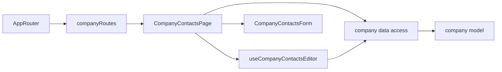

# Admin company contacts

**Status:** implemented. Route: `/company-contacts` (menu «Контакти»). Backend: KedrStore Content module, contract [company contacts](../../contracts/openapi/content/contacts.openapi.yaml); the public site shows the same record ([site company contacts](../site/company-contacts.md)).

- One [form](../../../libs/admin/company/ui/src/forms/company-contacts-form.tsx) on the [page](../../../libs/admin/company/feature/src/pages/company-contacts-page.tsx): sales phone, Viber number, email, Telegram link, map link, and the city in Ukrainian and Russian. All fields are required and saved together.
- Phones may be typed as `068 713 50 49`, `(068) 713-50-49` or `+380687135049`; the [save body](../../../libs/admin/company/data-access/src/mappers/company-contacts.mapper.ts) sends `+380…`. The [local rules](../../../libs/admin/company/model/src/validators/company-contacts-rules.ts) mirror the backend: Ukrainian numbers, an email, `https://` links, Telegram only on `t.me` or `telegram.me`. A server field error lands under its field.
- After a save the site shows the new values within ten minutes (its cache life).
- Every staff role (Manager and Admin) may edit, as the backend policy `CanManageContent`; the route has no extra guard.

## Architecture



## Code structure

```text
libs/admin/company/
├── model/src/entities/company-contacts.ts          # contacts and field limits
├── model/src/forms/company-contacts-draft.ts       # draft, comparison, phone normalization
├── model/src/validators/company-contacts-rules.ts  # field rules
├── data-access/src/api/admin-company-contacts.api.ts  # GET and PUT /api/admin/content/contacts
├── data-access/src/validators/                     # zod response schema
├── data-access/src/mappers/                        # response → model, save body
├── ui/src/forms/                                   # form, DraftTextField, FormSaveBar (shared with requisites)
└── feature/src/                                    # route, page, draft hook, shared save errors
```

## Tests

- `npx nx run admin-company-model:vite:test -- --run` — phone normalization and field rules.
- `npx nx run admin-company-data-access:vite:test -- --run` — response check and save body.
- `npx nx run admin-company-ui:vite:test -- --run` — fields, buttons, errors.
- `npx nx run admin-company-feature:vite:test -- --run` — save, local and server errors, retry.
