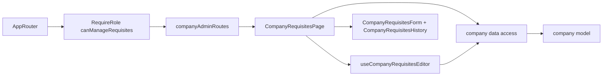

# Admin company requisites

**Status:** implemented. Route: `/company-requisites` (menu «Реквізити», Admins only). Backend: KedrStore Content module, contract [company requisites](../../contracts/openapi/content/requisites.openapi.yaml); the public requisites page shows the same record ([site requisites](../site/requisites.md)).

- One [form](../../../libs/admin/company/ui/src/forms/company-requisites-form.tsx) on the [page](../../../libs/admin/company/feature/src/pages/company-requisites-page.tsx): ФОП name, ЄДРПОУ/РНОКПП, extract number, IBAN, bank and МФО. All fields are required and saved together.
- The IBAN may be typed with spaces; the [save body](../../../libs/admin/company/data-access/src/mappers/company-requisites.mapper.ts) sends it without them. The [local rules](../../../libs/admin/company/model/src/validators/company-requisites-rules.ts) mirror the backend: code 8 or 10 digits, `UA` + 27 digits with a valid mod-97 checksum, a 6-digit МФО equal to digits 5–10 of the IBAN. A server field error lands under its field.
- The [history](../../../libs/admin/company/ui/src/details/company-requisites-history.tsx) beside the form lists the 50 latest saves: when (Kyiv time), who (email), and each field old → new, the IBAN grouped by four. A save with the same values adds nothing.
- A line «Змінено: дата · email» under the description repeats the newest history entry.
- After a save the site shows the new values within ten minutes (its cache life).
- Admins only, as the backend policy `RequireAdminRole`: the menu item is hidden from Managers and the route sits under `RequireRole allow={canManageRequisites}`.

## Architecture



## Code structure

```text
libs/admin/company/
├── model/src/entities/company-requisites.ts           # requisites, change entry, limits
├── model/src/forms/company-requisites-draft.ts        # draft, labels, IBAN normalize/format
├── model/src/validators/company-requisites-rules.ts   # field rules, IBAN checksum, МФО from IBAN
├── data-access/src/api/admin-company-requisites.api.ts  # GET/PUT and GET history
├── data-access/src/validators/company-requisites.schemas.ts
├── data-access/src/mappers/company-requisites.mapper.ts
├── ui/src/forms/company-requisites-form.tsx           # shares DraftTextField and FormSaveBar with contacts
├── ui/src/history/company-requisites-history.tsx      # change log list
└── feature/src/                                       # companyAdminRoutes, page, draft hook, shared save errors
```

## Tests

- `npx nx run admin-company-model:vite:test -- --run` — IBAN checksum, МФО match, code lengths.
- `npx nx run admin-company-data-access:vite:test -- --run` — save body and history response.
- `npx nx run admin-company-ui:vite:test -- --run` — form fields and history rows.
- `npx nx run admin-company-feature:vite:test -- --run` — save, МФО mismatch, server error, history, retry.
- `npx nx run admin-core-shell:vite:test -- --run` — menu item only for Admins.
