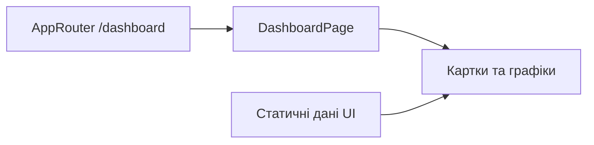

# Дашборд Admin

**Стан:** екран реалізовано; значення статистики в UI поки статичні, а не дані backend.

- **Маршрут:** [AppRouter](../../../apps/admin/src/app/router/app-router.tsx) підключає [dashboardRoutes](../../../libs/admin/dashboard/feature/src/dashboard.routes.tsx) за `/dashboard`.
- **Побудова:** [DashboardPage](../../../libs/admin/dashboard/feature/src/pages/dashboard-page.tsx) складає картки, останні товари й замовлення, графіки продажів і трафіку з компонентів `dashboard/feature`.
- **Дані й межа:** окремої dashboard `data-access` бібліотеки зараз немає. [Admin shell](../../../libs/admin/core/shell/src/index.ts) відповідає за макет і сесію. Для майбутніх реальних показників спочатку потрібен перевірений API-контракт.

## Схема будови



## Структура в коді

Фактичні точки входу й основні файли фічі (інші файли цих каталогів тут не перелічено):

```text
apps/admin/src/app/
└── router/app-router.tsx  # точка входу маршруту

libs/admin/core/shell/
└── src/index.ts  # публічний API бібліотеки

libs/admin/dashboard/
└── feature/src/
    ├── pages/dashboard-page.tsx  # сторінка та композиція UI
    └── dashboard.routes.tsx  # маршрути фічі
```
