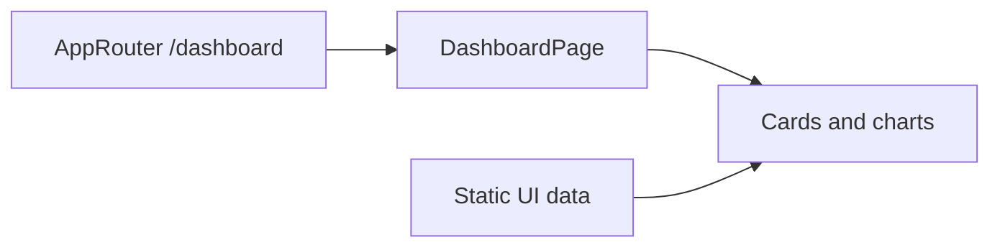

# Admin Dashboard

**Status:** the screen is implemented; the statistics shown in the UI are still static rather than backend data.

- **Route:** [AppRouter](../../../apps/admin/src/app/router/app-router.tsx) connects [dashboardRoutes](../../../libs/admin/dashboard/feature/src/dashboard.routes.tsx) at `/dashboard`.
- **Composition:** [DashboardPage](../../../libs/admin/dashboard/feature/src/pages/dashboard-page.tsx) composes cards, recent products and orders, and sales and traffic charts from `dashboard/feature` components.
- **Data and boundary:** there is currently no separate dashboard `data-access` library. [Admin shell](../../../libs/admin/core/shell/src/index.ts) is responsible for layout and session. Real metrics in the future require a verified API contract first.

## Architecture



## Code structure

Actual entry points and primary feature files (other files in these directories are omitted):

```text
apps/admin/src/app/
└── router/app-router.tsx  # route entry point

libs/admin/core/shell/
└── src/index.ts  # library public API

libs/admin/dashboard/
└── feature/src/
    ├── pages/dashboard-page.tsx  # page and UI composition
    └── dashboard.routes.tsx  # feature routes
```
