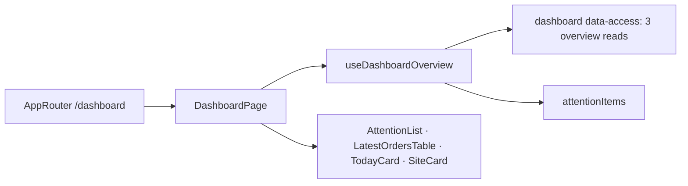

# Admin Dashboard («Огляд»)

**Status:** live data since 2026-11-05 (design «Робочий стіл», variant A chosen by the owner).

- **Route:** [AppRouter](../../../apps/admin/src/app/router/app-router.tsx) builds [createDashboardRoutes](../../../libs/admin/dashboard/feature/src/dashboard.routes.tsx) at `/dashboard` and passes the viewer's name and the «Оновити сайт зараз» button (`SiteRefreshButton variant="text"`).
- **Page:** [DashboardPage](../../../libs/admin/dashboard/feature/src/pages/dashboard-page.tsx) shows the Kyiv date and a greeting, «Нове замовлення» and «Нова стаття», then «Потребує уваги», «Останні замовлення», «Сьогодні» (orders today, drafts) and «Сайт».
- **Problems only:** [attentionItems](../../../libs/admin/dashboard/model/src/mappers/attention-items.ts) builds the attention list most urgent first: 1C refused orders, products without photo (with the category that has most), categories without site text, article drafts (with the oldest), article covers not in the media library, document drafts. A zero count or a block that did not load adds nothing, and the card is hidden when the list is empty; the first four are rows, the rest short links. The latest orders table marks only a 1C problem. No money sums or new-customer counts (owner's decision).
- **Data:** [admin-overview.api](../../../libs/admin/dashboard/data-access/src/api/admin-overview.api.ts) reads `GET /api/admin/order-workspace/overview`, `/api/admin/catalog/overview` and `/api/admin/content/overview` (KedrStore Platform 003), validated with zod and refetched on every visit. A failed block is named in one page notice; the others still show.

## Architecture



## Code structure

```text
libs/admin/dashboard/
├── model/src/
│   ├── entities/dashboard-overview.ts     # orders, catalog, content blocks
│   └── mappers/{attention-items,greeting,plural}.ts
├── data-access/src/
│   ├── api/admin-overview.api.ts          # three queries
│   ├── validators/overview.schemas.ts
│   └── mappers/overview.mapper.ts
├── ui/src/components/                     # attention list, today, latest orders, site card
└── feature/src/
    ├── dashboard.routes.tsx               # createDashboardRoutes
    ├── hooks/use-dashboard-overview.ts
    └── pages/dashboard-page.tsx
```

## Tests

- `npx nx run admin-dashboard-model:vite:test -- --run` — attention list, plurals, greeting, Kyiv date.
- `npx nx run admin-dashboard-data-access:vite:test -- --run` — response mapping.
- `npx nx run admin-dashboard-ui:vite:test -- --run` — attention list rows and links.
- `npx nx run admin-dashboard-feature:vite:test -- --run` — page with loaded, empty and failed blocks.
