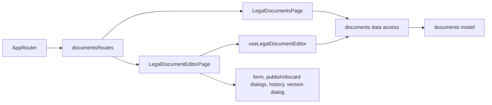

# Admin site documents

**Status:** implemented. Routes: `/documents`, `/documents/:kind` (menu «Сайт» → «Документи», all staff). Backend: KedrStore Content module, contract [site documents](../../contracts/openapi/content/documents.openapi.yaml); the site pages show the published edition ([public offer](../site/public-offer.md), [privacy policy](../site/privacy-policy.md), [returns](../site/returns-exchanges.md), [delivery and payment](../site/delivery-payment.md)).

- The [list](../../../libs/admin/documents/ui/src/tables/legal-documents-list.tsx) shows the four documents with the edition on the site («На сайті: редакція №2 від 10.11.2026») and marks a waiting draft.
- The [editor](../../../libs/admin/documents/feature/src/pages/legal-document-editor-page.tsx) opens the draft, or the text on the site when there is none. Both languages sit in tabs: the full title and the body in the shared rich text editor with quotes turned on; H2 headings become the sections and the table of contents on the site. `{site}`, `{email}` and `{phone}` in the text are filled by the site with its host and the saved contacts.
- «Зберегти чернетку» saves without touching the site (the first save creates the draft). «Опублікувати» saves unsaved changes, then publishes: the [dialog](../../../libs/admin/documents/ui/src/dialogs/publish-legal-document-dialog.tsx) asks «Редакція від» for the three legal texts (not earlier than the edition on the site) and publishes delivery & payment with today's date without asking. «Видалити чернетку» drops unpublished changes.
- [Історія редакцій](../../../libs/admin/documents/ui/src/details/legal-document-history.tsx) is collapsed: number, date, who and when published; an old edition opens read-only and its text can be taken into the form.
- The editor names who published the edition on the site and when («Опубліковано: дата · email»), and who saved a waiting draft.
- After publishing, the site shows the new edition within ten minutes (its cache life).

## Architecture



## Code structure

```text
libs/admin/documents/
├── model/src/entities/legal-document.ts          # kinds with labels and «Редакція від» flag, versions, limits
├── model/src/forms/legal-document-draft.ts       # both-language draft, compare
├── model/src/validators/legal-document-rules.ts  # required title/body, date not before the current edition
├── data-access/src/api/admin-legal-documents.api.ts  # list, versions, version, create/update/delete draft, publish
├── data-access/src/validators/legal-documents.schemas.ts
├── data-access/src/mappers/legal-document.mapper.ts
├── ui/src/{list,forms,dialogs,history}/          # list, uk/ru form, publish/discard/version dialogs, history
└── feature/src/                                   # documentsRoutes, pages, editor hook, error messages
```

The quote button is the `allowQuotes` option of the shared [RichTextEditor](../../../libs/admin/shared/ui/src/lib/inputs/rich-text-editor/rich-text-editor.tsx); articles and category texts keep it off.

## Tests

- `npx nx run admin-documents-model:vite:test -- --run` — required texts, date rules.
- `npx nx run admin-documents-data-access:vite:test -- --run` — version response and save body.
- `npx nx run admin-documents-ui:vite:test -- --run` — list state and links.
- `npx nx run admin-documents-feature:vite:test -- --run` — publish with a date, date too early, delivery without a date, error messages.
