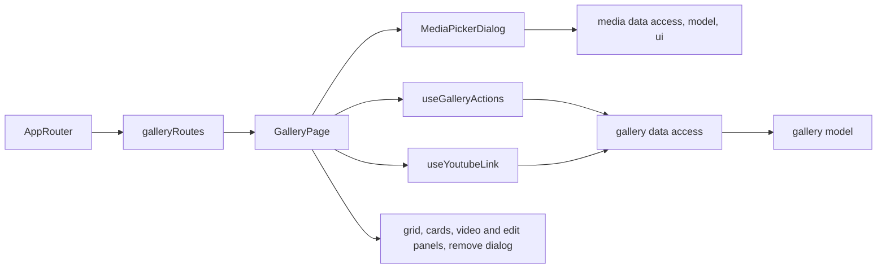

# Admin site gallery

**Status:** implemented. Route: `/gallery` (menu «Сайт» → «Галерея», all staff). Backend: KedrStore Content module, contract [site gallery](../../contracts/openapi/content/gallery.openapi.yaml); the [site gallery](../site/gallery.md) shows the cards in the same order.

- The [grid](../../../libs/admin/gallery/ui/src/cards/gallery-grid.tsx) shows every card in site order: number, «Фото» or «Відео», picture or YouTube poster, the Ukrainian title or «Без назви». Cards move by drag and drop or the arrow buttons; the new order is shown at once and rolled back with a message if saving fails.
- «Додати фото» opens the [media picker](../../../libs/admin/gallery/feature/src/components/media-picker-dialog.tsx): folder, search, a page of library files without the ones already in the gallery. Files can be uploaded from the computer or dropped into it; uploaded files come back selected. Up to 100 photos go to the end in the order they were picked. The gallery keeps only the file IDs, so a renamed or moved file stays in place; a deleted file shows a warning and the site hides that card.
- «Додати відео» opens the [video panel](../../../libs/admin/gallery/ui/src/panels/add-video-panel.tsx) on the right: paste any YouTube link (watch, youtu.be, shorts, embed or the bare ID). The poster and YouTube's title appear and fill both titles; they can be changed or translated before adding. A video already in the gallery is refused. If YouTube does not answer, the title is typed by hand.
- The pencil opens [titles and captions](../../../libs/admin/gallery/ui/src/panels/edit-gallery-item-panel.tsx) in the right edit panel, in both languages (title up to 150, caption up to 500 characters; empty means none). Removing a card keeps the photo in the media library.
- The site shows changes within ten minutes (its cache life).

## Architecture



The feature uses the media library through its public `data-access`, `model` and `ui` entries (documented flows in `tools/architecture/project-boundary-rules.mjs`).

## Code structure

```text
libs/admin/gallery/
├── model/src/entities/gallery-item.ts         # card, texts, YouTube preview, limits
├── model/src/forms/gallery-texts.ts           # empty texts, texts from the YouTube title, card label
├── model/src/validators/gallery-rules.ts      # YouTube link parsing, text limits, move in order
├── data-access/src/api/admin-gallery.api.ts   # list, add photos/video, preview, update, delete, optimistic reorder
├── data-access/src/{contracts,validators,mappers}/
├── ui/src/cards/                               # grid with drag and drop, card
├── ui/src/forms/gallery-texts-fields.tsx       # uk/ru title and caption
├── ui/src/panels/                              # add video, edit texts (right edit panel)
├── ui/src/dialogs/                             # remove confirmation
└── feature/src/                                # galleryRoutes, page, media picker, hooks, error messages
```

## Tests

- `npx nx run admin-gallery-model:vite:test -- --run` — YouTube links, limits, moves.
- `npx nx run admin-gallery-data-access:vite:test -- --run` — response mapping.
- `npx nx run admin-gallery-ui:vite:test -- --run` — empty state and grid.
- `npx nx run admin-gallery-feature:vite:test -- --run` — adding a pasted link, reorder, remove error, error messages.
