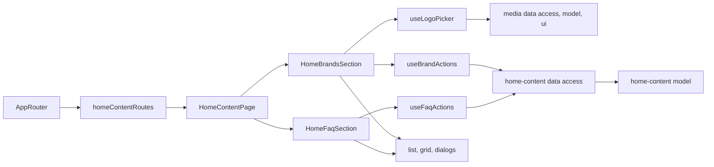

# Admin home page blocks

**Status:** implemented. Route: `/home-content` (menu «Сайт» → «Головна сторінка», all staff). Backend: KedrStore Content module, contract [home page FAQ and brands](../../contracts/openapi/content/home.openapi.yaml); the [site home page](../site/home.md) shows both lists in the same order.

- Two tabs with counters. **«Питання»**: the home FAQ in site order, the Ukrainian question with the start of its answer. A question has a question and an answer in Ukrainian and Russian, all four required (question up to 200, answer up to 2000 characters). The first question is open on the site. An empty list hides the FAQ block on the site.
- **«Бренди»**: logo cards on white, as on the site. A brand has a name (up to 100 characters) and a logo from the media library: «Вибрати з медіатеки» opens the shared [media picker](../../../libs/admin/media/ui/src/dialogs/media-picker-dialog.tsx) (search, one file), «Завантажити з комп’ютера» uploads a JPEG, PNG or WebP into the library root. The brand keeps only the file ID; a deleted logo shows a warning, the site hides that brand, and the dialog asks for a new logo. While no brand is added the site shows its six built-in logos.
- Arrows move a question up or down and a brand earlier or later; the new order is shown at once and rolled back with a message if saving fails (409 when someone else changed the list).
- Every change answers with both lists, which replace the cached ones. The site shows changes within ten minutes (its cache life).

## Architecture



The feature uses the media library through its public `data-access`, `model` and `ui` entries (documented flows in `tools/architecture/project-boundary-rules.mjs`).

## Code structure

```text
libs/admin/home-content/
├── model/src/entities/home-blocks.ts          # question, brand, both lists, limits
├── model/src/forms/home-forms.ts              # empty texts, brand draft with its logo
├── model/src/validators/home-rules.ts         # required uk/ru texts, name and logo, move in order
├── data-access/src/api/admin-home-content.api.ts  # list, add/update/delete, optimistic reorder for both lists
├── data-access/src/{contracts,validators,mappers}/
├── ui/src/faq/                                 # question list, question dialog
├── ui/src/brands/                              # logo grid, brand dialog
├── ui/src/order/move-buttons.tsx               # up/down or earlier/later arrows
├── ui/src/dialogs/remove-home-item-dialog.tsx
└── feature/src/                                # homeContentRoutes, page with tabs, sections, hooks, error messages
```

## Tests

- `npx nx run admin-home-content-model:vite:test -- --run` — required texts, limits, moves.
- `npx nx run admin-home-content-data-access:vite:test -- --run` — response mapping, trimmed requests.
- `npx nx run admin-home-content-ui:vite:test -- --run` — list arrows and empty state.
- `npx nx run admin-home-content-feature:vite:test -- --run` — adding a question, a refused reorder, replacing a deleted logo by upload, error messages.
