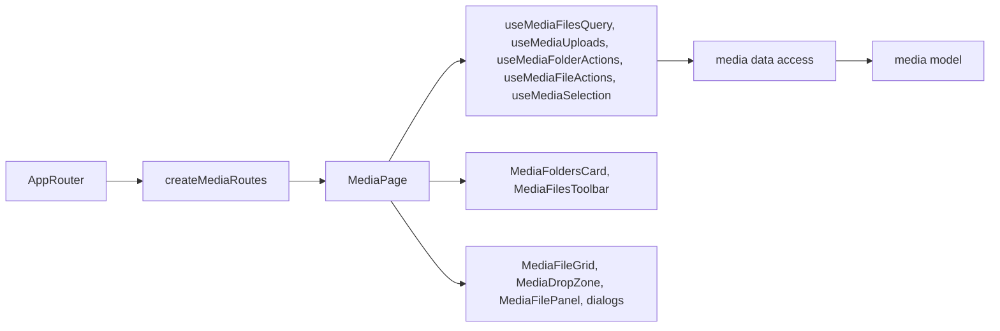

# Admin Media

**Status:** implemented (stage 2 of the media library). Route: `/media`. Backend: KedrStore module Media, consumer page [admin media library](../../contracts/media/admin-media.md); specification [media library](../../specs/admin/media/001-media-library/README.md).

- One library for every picture on the CDN. The [page](../../../libs/admin/media/feature/src/pages/media-page.tsx) has the folder tree on the left («Усі файли», «Без папки», nested folders with counts) and the grid on the right with search by name and 60 files per page.
- Folders are virtual: creating, renaming, or moving a folder or file never changes a file URL. A folder cannot move into itself or its subfolder.
- Upload: the «Завантажити» button or files dragged onto the grid go to the selected folder (the root when «Усі файли» or «Без папки» is selected). JPEG, PNG, or WebP up to 15 MB; a wrong file is listed with its reason and the rest upload one by one with progress.
- A file opens in the side panel: preview, «Відкрити», «Копіювати посилання», name and folder, type, size, resolution (unknown for files registered from the CDN), dates, «Замінити файл» (same ID, new URL).
- Several files are selected with the card checkbox and moved together.
- Manager and Admin manage the library (backend policy `CanManageMedia`); only an Admin sees «Видалити» for files and folders (`canDeleteMedia`, backend `RequireAdminRole`). Deleting asks first; a file is removed from the CDN for good, a folder only when empty.

## Architecture



## Code structure

```text
libs/admin/media/
├── model/src/entities/                 # file, folder, limits, accepted types
├── model/src/queries/                  # scope (all, root, folder), page size, upload folder
├── model/src/mappers/                  # folder tree, path, size and resolution text
├── model/src/validators/               # upload, folder name, file name rules
├── data-access/src/api/admin-media.api.ts  # folders and files endpoints, tags
├── data-access/src/{contracts,validators,mappers}/  # DTO types, zod schemas, mapping, query params
├── ui/src/components/folder-tree/      # tree and folder menu
├── ui/src/components/file-grid/        # grid with states, file card
├── ui/src/components/upload/           # drag-and-drop zone
├── ui/src/details/media-file-panel.tsx # side panel
├── ui/src/dialogs/                     # folder, move, delete confirmation
├── ui/src/forms/media-folder-select.tsx  # indented folder select
└── feature/src/                        # route, page, page parts, hooks, errors
```

## Tests

- `npx nx run admin-media-model:vite:test -- --run` — folder tree, upload and name rules.
- `npx nx run admin-media-data-access:vite:test -- --run` — mapping and query parameters.
- `npx nx run admin-media-ui:vite:test -- --run` — folder dialog name check and blocked places.
- `npx nx run admin-media-feature:vite:test -- --run` — folder scope, upload with a skipped file, Manager and Admin delete, non-empty folder, new subfolder, error wording.
