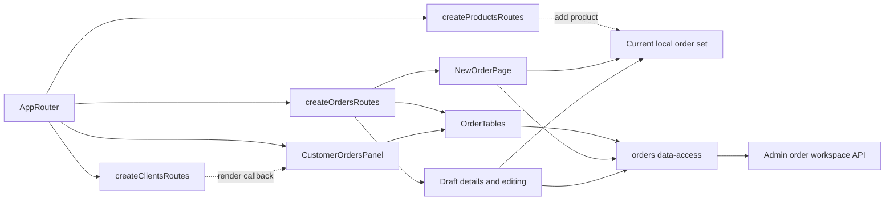

# React Admin orders

**Status:** implemented in React Admin. Routes: `/orders`, `/orders/new`, `/orders/:orderId`, `/orders/drafts/:draftId`, and draft editing. Requirements and verification: [orders SDD](../../specs/admin/orders/001-order-workspace/README.md), [customer prices and discount/markup SDD](../../specs/admin/orders/003-customer-prices-and-adjustments/README.md), and [customer panel SDD](../../specs/admin/clients/002-customer-orders/README.md).

## Flow and data

- [Tables](../../../libs/admin/orders/feature/src/components/order-tables.tsx) have order and draft tabs, separate URL state, and server-side search, creation date range, sorting, and pagination. On a customer page, the query is restricted to that customer's ID, and the customer column and search are hidden from the order table. [Draft deletion](../../../libs/admin/orders/feature/src/hooks/use-draft-deletion.ts) is separate from table management. The same panel is used in [customer details](clients.md).
- The [local order set](../../../libs/admin/orders/feature/src/state/current-order-set.ts) receives products from the catalog and stores only productId, quantity, and the per-unit adjustment in browser storage; the checkout customer is kept next to it in [current-order-customer](../../../libs/admin/orders/feature/src/state/current-order-customer.ts) until submit, draft creation, or logout. Storage is per browser profile, not per account. Its item count appears in the MUI cart in the header. The [checkout page](../../../libs/admin/orders/feature/src/pages/new-order-page.tsx) selects customers with paginated loading, shows product names and a preliminary total, coordinates the server quote, and opens MUI dialogs for saving a draft and submitting an order.
- **Prices and discount/markup.** With a customer chosen, the [line editor](../../../libs/admin/orders/ui/src/forms/order-line-editor.tsx) shows «Ціна клієнта» from [customer prices](../../../libs/admin/orders/feature/src/hooks/use-customer-prices.ts) (the customer's category rule, inherited by subcategories; independent of stock); without one it shows «Ціна (роздріб)» from the catalog. Each line has a «Знижка/Націнка, ₴ за шт.» field ([price-adjustment](../../../libs/admin/orders/model/src/price-adjustment.ts)): minus is a discount (red), plus or a bare number a markup (green). A discount may not take the unit price below 1 ₴; the line explains why under the field. The adjustment goes to the server quote, drafts, and the order; 1C receives only amounts. Blocking errors appear in a pinned [PageIssues](../../../libs/admin/shared/ui/src/lib/page-issues.tsx) block with the server's reason ([quote errors](../../../libs/admin/orders/feature/src/errors/quote-error-message.ts)); after an order or draft is saved, the next page shows a success notice ([route notice](../../../libs/admin/orders/feature/src/hooks/use-route-notice.ts)), as set by the [feedback rules](../../standards/admin/feedback-and-errors.md). Details show a per-unit adjustment column when a line has one, and the order list shows the order's total adjustment.
- Details pages show the order and 1C status. A saved draft can be viewed, changed, deleted, or reused. The source draft remains after reuse.
- If a quote rejects a quantity because of current stock, the page shows the server message with the product name and available and requested quantities; the current set remains available for correction.
- The separate [Admin API](../../contracts/sales/admin-order-workspace.md) defines records, versions, idempotency, and errors. The UI follows the [list and detail page standard](../../standards/admin/list-detail-pages.md).

**Limitation:** the local set is cleared on explicit sign-out, but the current session does not provide a stable account ID for separate browser-storage keys. Changing accounts without signing out in the same browser profile can leave the previous session's set.

## Structure diagram



## Code structure

```text
libs/admin/orders/
├── model/src/orders-model.ts                 # page, quote, and draft models
├── model/src/price-adjustment.ts             # parse, format, apply a per-unit discount/markup
├── data-access/src/
│   ├── api/                                  # Admin endpoints, RTK Query tags, conflict mapping
│   └── mappers/                              # runtime validation, DTO → model
├── feature/src/
│   ├── orders.routes.tsx                     # routes and CustomerOrdersPanel
│   ├── components/order-tables.tsx           # tabs, URL, and server requests
│   ├── pages/                                # checkout, order/draft details, editing
│   ├── hooks/                                # quote, customer prices, checkout, draft save/deletion
│   ├── dialogs/                              # separate delete and reuse confirmations
│   └── state/current-order-set.ts            # local set and multi-tab coordination
└── ui/src/
    ├── components/order-status-chip.tsx      # 1C code → Ukrainian label and tone
    ├── tables/                               # grid and toolbar without HTTP
    ├── details/                              # document display
    ├── forms/                                # item editor and action forms
    ├── forms/order-lines/                    # price source priority, line row, adjustment field
    └── dialogs/                              # checkout confirmation
```

Customer selection is provided by the app adapter [CustomerPicker](../../../apps/admin/src/app/customer-picker.tsx). Products are added on the shared [picker page](../../../libs/admin/orders/feature/src/pages/product-picker-page.tsx) (`/orders/pick-products` for the order set, `/orders/drafts/:draftId/pick-products` for an edited draft; unsaved draft edits live in [session state](../../../libs/admin/orders/feature/src/state/draft-edit-session.ts)). To show names and base prices during checkout, `admin-orders-feature` also reads the catalog through `admin-products-data-access`; feature → data-access dependencies across domains are permitted. Orders has no other direct imports from the clients or products domains.

## Tests

Spec files sit next to the code in each project. Focused runs:

- `apps/admin` (3 spec files): `npx nx run admin:vite:test -- --run`
- `libs/admin/orders/data-access` (1 spec files): `npx nx run admin-orders-data-access:vite:test -- --run`
- `libs/admin/orders/feature` (6 spec files): `npx nx run admin-orders-feature:vite:test -- --run`
- `libs/admin/orders/ui` (4 spec files): `npx nx run admin-orders-ui:vite:test -- --run`

- `libs/admin/orders/model` (1 spec file): `npx nx run admin-orders-model:vite:test -- --run`
