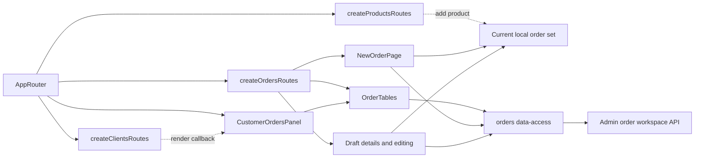

# React Admin orders

**Status:** implemented in React Admin. Routes: `/orders`, `/orders/new`, `/orders/:orderId`, `/orders/drafts/:draftId`, and draft editing. 1C delivery: KedrStore platform spec 006 (orders go to 1C through the shared outbox). Requirements and verification: [orders SDD](../../specs/admin/orders/001-order-workspace/README.md), [customer prices and discount/markup SDD](../../specs/admin/orders/003-customer-prices-and-adjustments/README.md), and [customer panel SDD](../../specs/admin/clients/002-customer-orders/README.md).

## Flow and data

- **Menu.** In «Продаж» the item «Замовлення» opens the current order (`/orders/new`, the same page as the cart icon in the top bar) and «Історія замовлень» opens the lists (`/orders`, page title «Історія замовлень»); the history item is not highlighted on `/orders/new` ([navigation](../../../libs/admin/core/shell/src/navigation/menu/navigation-groups.tsx)).
- [Tables](../../../libs/admin/orders/feature/src/components/order-tables.tsx) have order and draft tabs, separate URL state, and server-side search, creation date range, sorting, and pagination. On a customer page, the query is restricted to that customer's ID, and the customer column and search are hidden from the order table. [Draft deletion](../../../libs/admin/orders/feature/src/hooks/list/use-draft-deletion.ts) is separate from table management. The same panel is used in [customer details](clients.md).
- The [local order set](../../../libs/admin/orders/feature/src/state/current-order-set.ts) receives products from the catalog and stores only productId, quantity, and the per-unit adjustment in browser storage; the checkout customer is kept next to it in [current-order-customer](../../../libs/admin/orders/feature/src/state/current-order-customer.ts) until submit, draft creation, or logout. Storage is per browser profile, not per account. Its item count appears in the MUI cart in the header. The [checkout page](../../../libs/admin/orders/feature/src/pages/new-order-page.tsx) selects customers with paginated loading, shows product names and a preliminary total, coordinates the server quote, and opens MUI dialogs for saving a draft and submitting an order.
- **Prices and discount/markup.** With a customer chosen, the [line editor](../../../libs/admin/orders/ui/src/forms/order-line-editor.tsx) shows «Ціна клієнта» from [customer prices](../../../libs/admin/orders/feature/src/hooks/editor/use-customer-prices.ts) (the customer's category rule, inherited by subcategories; independent of stock); without one it shows «Ціна (роздріб)» from the catalog. Each line has a «Знижка/Націнка, ₴ за шт.» field ([price-adjustment](../../../libs/admin/orders/model/src/mappers/price-adjustment.ts)): minus is a discount (red), plus or a bare number a markup (green). A discount may not take the unit price below 1 ₴; the line explains why under the field. The adjustment goes to the server quote, drafts, and the order; 1C receives only amounts. Blocking errors appear in a pinned [PageIssues](../../../libs/admin/shared/ui/src/lib/feedback/page-issues.tsx) block with the server's reason ([quote errors](../../../libs/admin/orders/feature/src/errors/quote-error-message.ts)); after an order or draft is saved, the next page shows a success notice ([route notice](../../../libs/admin/shared/routing/src/lib/route-notice.ts)), as set by the [feedback rules](../../standards/admin/feedback-and-errors.md). Details show a per-unit adjustment column when a line has one, and the order list shows the order's total adjustment.
- **Site orders** (KedrStore spec sales/009, R-015, 2026-11-27). An order made from a site order shows the column «З сайту» with the site order number (`№ 52992220`) as a link to [«Замовлення з сайту»](site-orders.md) ([site-order-link](../../../libs/admin/orders/ui/src/components/site-order-link.tsx)); the click opens the site order, not the order. A manager's order leaves the cell empty. Order details show the same link in the «Документ» card as «Замовлення з сайту».
- **1C status.** The order table keeps one «1C» column with the Ukrainian label ([order-status-chip](../../../libs/admin/orders/ui/src/components/order-status-chip.tsx)): «Очікує відправлення», «Заплановано повтор», «Прийнято в 1С», «Помилка обробки в 1С», «Потрібна перевірка». Only a problem gets a line under the label ([order-sync-note](../../../libs/admin/orders/ui/src/components/order-sync-note.tsx)): the 1C refusal or the last error, the number of attempts and the next automatic attempt; a click on that line opens the whole error text (for a SOAP fault «FaultException: …» with 1C's reason) without opening the order; a good state shows nothing extra. Order details show the card «Стан відправлення» ([order-sync-card](../../../libs/admin/orders/ui/src/details/order-sync-card.tsx)) with the 1C document, the reason, attempts, last and next attempt. For «Помилка обробки в 1С» and «Потрібна перевірка» it offers «Повторити», which opens the right-side [retry panel](../../../libs/admin/orders/feature/src/components/order-sync-retry-panel.tsx): the manager writes what was fixed (required, up to 500 characters) and the order goes back in the queue (`POST /api/admin/orders/{orderId}/sync/retry`, [order-sync.api](../../../libs/admin/orders/data-access/src/api/order-sync.api.ts)); the next scheduler run sends it with the same number. The button is locked while the request runs; a 409 means the order was accepted or queued meanwhile.
- A saved draft can be viewed, changed, deleted, or reused. The source draft remains after reuse.
- If a quote rejects a quantity because of current stock, the page shows the server message with the product name and available and requested quantities; the current set remains available for correction.
- The separate [Admin API](../../contracts/sales/admin-order-workspace.md) defines records, versions, idempotency, and errors. The UI follows the [list and detail page standard](../../standards/admin/list-detail-pages.md).

**Limitation:** the local set is cleared on explicit sign-out, but the current session does not provide a stable account ID for separate browser-storage keys. Changing accounts without signing out in the same browser profile can leave the previous session's set.

## Structure diagram



## Code structure

```text
libs/admin/orders/
├── model/src/entities/orders-model.ts        # page, quote, and draft models
├── model/src/mappers/price-adjustment.ts     # parse, format, apply a per-unit discount/markup
├── data-access/src/
│   ├── api/                                  # Admin endpoints, RTK Query tags, conflict mapping
│   ├── validators/orders.schemas.ts          # runtime validation (zod)
│   └── mappers/                              # validated DTO → model
├── feature/src/
│   ├── orders.routes.tsx                     # routes and CustomerOrdersPanel
│   ├── components/order-tables.tsx           # tabs, URL, and server requests
│   ├── components/order-sync-retry-panel.tsx # «Повторити»: reason, retry request, conflict message
│   ├── pages/                                # checkout, order/draft details, editing
│   ├── hooks/                                # quote, customer prices, checkout, draft save/deletion
│   ├── dialogs/                              # separate delete and reuse confirmations
│   └── state/current-order-set*.ts           # local set, multi-tab coordination, storage format
└── ui/src/
    ├── components/order-status-chip.tsx      # 1C code → Ukrainian label and tone; which states can be retried
    ├── components/order-sync-note.tsx        # reason and attempts of a problem under the label
    ├── components/site-order-link.tsx        # «№ 52992220» link to the site order an order was made from
    ├── tables/                               # grid, columns, sort, row actions, toolbar
    ├── details/                              # document display, «Стан відправлення» card
    ├── forms/                                # item editor and action forms
    ├── forms/order-lines/                    # price source priority, line row, adjustment field
    └── dialogs/                              # checkout confirmation
```

Customer selection is provided by the app slot [CustomerPicker](../../../apps/admin/src/app/slots/customer-picker/customer-picker.tsx) (paging in `use-customer-options.ts`, page merging in `customer-options.ts`). Products are added on the shared [picker page](../../../libs/admin/orders/feature/src/pages/product-picker-page.tsx) (`/orders/pick-products` for the order set, `/orders/drafts/:draftId/pick-products` for an edited draft; unsaved draft edits live in [session state](../../../libs/admin/orders/feature/src/state/draft-edit-session.ts)). To show names and base prices during checkout, `admin-orders-feature` also reads the catalog through `admin-products-data-access`; feature → data-access dependencies across domains are permitted. Orders has no other direct imports from the clients or products domains.

## Tests

Spec files sit next to the code in each project. Focused runs:

- `apps/admin` (3 spec files): `npx nx run admin:vite:test -- --run`
- `libs/admin/orders/data-access` (1 spec files): `npx nx run admin-orders-data-access:vite:test -- --run`
- `libs/admin/orders/feature` (9 spec files): `npx nx run admin-orders-feature:vite:test -- --run`
- `libs/admin/orders/ui` (5 spec files): `npx nx run admin-orders-ui:vite:test -- --run`

- `libs/admin/orders/model` (1 spec file): `npx nx run admin-orders-model:vite:test -- --run`
