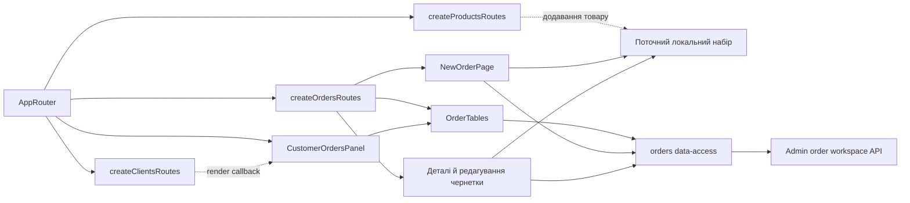

# Замовлення React Admin

**Стан:** реалізовано в React Admin. Маршрути: `/orders`, `/orders/new`, `/orders/:orderId`, `/orders/drafts/:draftId` і редагування чернетки. Вимоги та перевірки: [SDD замовлень](../../specs/admin/orders/001-order-workspace/README.md) і [SDD панелі клієнта](../../specs/admin/clients/002-customer-orders/README.md).

## Потік і дані

- [Таблиці](../../../libs/admin/orders/feature/src/components/order-tables.tsx) мають вкладки замовлень і чернеток, окремий URL-стан та серверні пошук, фільтр клієнта, сортування й пагінацію; [видалення чернетки](../../../libs/admin/orders/feature/src/hooks/use-draft-deletion.ts) відділено від керування таблицями. Та сама панель працює в [деталях клієнта](clients.md).
- [Локальний набір](../../../libs/admin/orders/feature/src/state/current-order-set.ts) отримує товари з каталогу й зберігає лише productId/quantity у browser storage. [Сторінка оформлення](../../../libs/admin/orders/feature/src/pages/new-order-page.tsx) обирає клієнта й координує quote; [збереження чернетки](../../../libs/admin/orders/feature/src/hooks/use-save-draft.ts) та [створення замовлення](../../../libs/admin/orders/feature/src/hooks/use-submit-order.ts) мають окремі потоки.
- Сторінки деталей показують замовлення та стан 1C; збережену чернетку можна переглянути, змінити, видалити або повторно використати. Джерельна чернетка при повторному оформленні залишається.
- Окремий [Admin API](../../contracts/sales/admin-order-workspace.md) визначає записи, версії, ідемпотентність і помилки. UI відповідає [стандарту сторінок](../../standards/admin/list-detail-pages.md).

**Обмеження:** локальний набір очищується при явному виході, але поточна сесія не дає стабільного account ID для окремих browser-storage ключів. Зміна облікового запису без виходу в тому самому профілі може залишити набір попередньої сесії.

## Схема будови



## Структура в коді

```text
libs/admin/orders/
├── model/src/orders-model.ts                 # моделі сторінок, quote, чернетки
├── data-access/src/
│   ├── api/                                  # Admin endpoints, RTK Query tags, conflict mapping
│   └── mappers/                              # runtime validation, DTO → model
├── feature/src/
│   ├── orders.routes.tsx                     # маршрути й CustomerOrdersPanel
│   ├── components/order-tables.tsx           # вкладки, URL і серверні запити
│   ├── pages/                                # checkout, order/draft details, edit
│   ├── hooks/                                # quote, checkout, draft save/deletion
│   ├── dialogs/                              # окремі підтвердження видалення й повтору
│   └── state/current-order-set.ts            # локальний набір, multi-tab узгодження
└── ui/src/
    ├── tables/                               # grid і toolbar без HTTP
    ├── details/                              # відображення документа
    ├── forms/                                # редактор позицій і форми дій
    └── dialogs/                              # підтвердження оформлення
```

Підбір клієнта й товару надають app adapters: [CustomerPicker](../../../apps/admin/src/app/customer-picker.tsx) та [ProductPicker](../../../apps/admin/src/app/product-picker.tsx). Orders domain не імпортує clients/products domains напряму.
