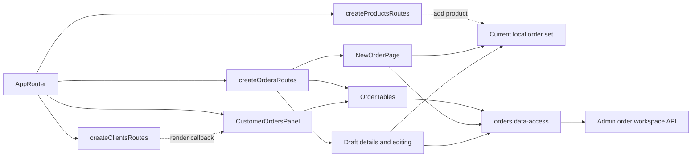

# React Admin orders

**Status:** implemented in React Admin. Routes: `/orders`, `/orders/new`, `/orders/:orderId`, `/orders/drafts/:draftId`, and draft editing. Requirements and verification: [orders SDD](../../specs/admin/orders/001-order-workspace/README.md) and [customer panel SDD](../../specs/admin/clients/002-customer-orders/README.md).

## Flow and data

- [Tables](../../../libs/admin/orders/feature/src/components/order-tables.tsx) have order and draft tabs, separate URL state, and server-side search, creation date range, sorting, and pagination. On a customer page, the query is restricted to that customer's ID, and the customer column and search are hidden from the order table. [Draft deletion](../../../libs/admin/orders/feature/src/hooks/use-draft-deletion.ts) is separate from table management. The same panel is used in [customer details](clients.md).
- The [local order set](../../../libs/admin/orders/feature/src/state/current-order-set.ts) receives products from the catalog and stores only productId/quantity in browser storage. Its item count appears in the MUI cart in the header. The [checkout page](../../../libs/admin/orders/feature/src/pages/new-order-page.tsx) selects customers with paginated loading, shows product names and a preliminary total, coordinates the server quote, and opens MUI dialogs for saving a draft and submitting an order.
- Details pages show the order and 1C status. A saved draft can be viewed, changed, deleted, or reused. The source draft remains after reuse.
- If a quote rejects a quantity because of current stock, the page shows the server message with the product name and available and requested quantities; the current set remains available for correction.
- The separate [Admin API](../../contracts/sales/admin-order-workspace.md) defines records, versions, idempotency, and errors. The UI follows the [list and detail page standard](../../standards/admin/list-detail-pages.md).

**Limitation:** the local set is cleared on explicit sign-out, but the current session does not provide a stable account ID for separate browser-storage keys. Changing accounts without signing out in the same browser profile can leave the previous session's set.

## Structure diagram



## Code structure

```text
libs/admin/orders/
├── model/src/orders-model.ts                 # page, quote, and draft models
├── data-access/src/
│   ├── api/                                  # Admin endpoints, RTK Query tags, conflict mapping
│   └── mappers/                              # runtime validation, DTO → model
├── feature/src/
│   ├── orders.routes.tsx                     # routes and CustomerOrdersPanel
│   ├── components/order-tables.tsx           # tabs, URL, and server requests
│   ├── pages/                                # checkout, order/draft details, editing
│   ├── hooks/                                # quote, checkout, draft save/deletion
│   ├── dialogs/                              # separate delete and reuse confirmations
│   └── state/current-order-set.ts            # local set and multi-tab coordination
└── ui/src/
    ├── tables/                               # grid and toolbar without HTTP
    ├── details/                              # document display
    ├── forms/                                # item editor and action forms
    └── dialogs/                              # checkout confirmation
```

Customer and product selection are provided by app adapters: [CustomerPicker](../../../apps/admin/src/app/customer-picker.tsx) and [ProductPicker](../../../apps/admin/src/app/product-picker.tsx). To show names and base prices during checkout, `admin-orders-feature` also reads the catalog through `admin-products-data-access`; feature → data-access dependencies across domains are permitted. Orders has no other direct imports from the clients or products domains.
