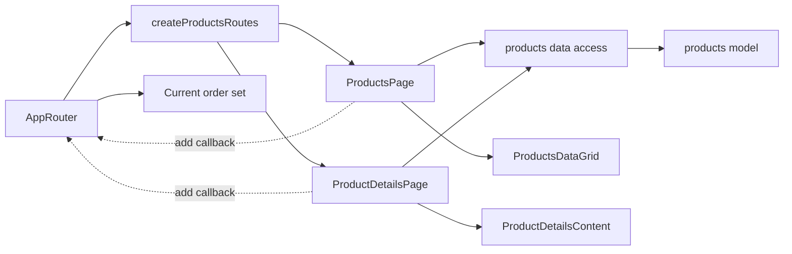

# Admin Products

**Status:** implemented. Routes: `/catalog` and `/catalog/:productSlug`. Requirements and checks: [read-only browsing SDD](../../specs/admin/products/001-read-only-product-browsing/README.md); composition rules: [Admin standard](../../standards/admin/list-detail-pages.md).

- The [list](../../../libs/admin/products/feature/src/pages/products-page.tsx) has modes “Усі товари”, “Без фото” (`withoutPhoto=true`: no linked photo), and “На сайті”; administrators also get “Видалені” ([DeletedProductsDataGrid](../../../libs/admin/products/ui/src/tables/deleted-products-data-grid.tsx), search and paging only). [ProductsDataGrid](../../../libs/admin/products/ui/src/tables/products-data-grid.tsx) sends supported search, filters, sorting, and pagination to the server; tab state is stored in the URL.
- [Details](../../../libs/admin/products/feature/src/pages/product-details-page.tsx) show product data, the photo and scheme block, and the public address `/uk/product/{slug}`, and return to the previous list state. Administrators change the address with the shared `ChangeSlugDialog`; the page then moves to the new address (see [categories](categories.md)). The list and details can add a product to the [current order set](orders.md) through an AppRouter callback.
- The [photo and scheme block](../../../libs/admin/products/feature/src/components/product-media-section.tsx) ([ProductMediaCard](../../../libs/admin/products/ui/src/components/media/product-media-card.tsx)) edits the product's gallery (up to 20 photos, order by arrows, first is the main one) and one scheme through `GET`/`PUT /api/admin/products/{id}/media`. Files are uploaded to the [media library](media.md) folders «Товари» and «Схеми» or picked there with [MediaPickerDialog](../../../libs/admin/media/ui/src/dialogs/media-picker-dialog.tsx); nothing is saved until «Зберегти». Manager and Admin can edit.
- [Products data access](../../../libs/admin/products/data-access/src/api/admin-products.api.ts) handles requests and mapping. Operations are described in the [products contract](../../contracts/catalog/admin-products.md) and [missing-photo products contract](../../contracts/catalog/missing-photo-products.md).

## Architecture



## Code structure

```text
libs/admin/products/
├── feature/src/products.routes.tsx               # routes and add callback
├── feature/src/pages/products-page.tsx           # list page composition
├── feature/src/pages/product-details-page.tsx    # product details and address change
├── feature/src/components/product-media-section.tsx  # photo and scheme editing
├── feature/src/hooks/                            # list URL state, list data, slug change, media editor and picker
├── feature/src/model/                            # URL ↔ list query, grid filters, add-to-order notice
├── data-access/src/api/admin-products.api.ts     # catalog requests
├── data-access/src/mappers/                     # DTO → model projection
├── data-access/src/validators/                  # runtime schemas of media responses
├── model/src/                                   # product types, parameters, media set rules
└── ui/src/
    ├── tables/                                  # products and deleted grids, columns, sort, cells
    ├── tables/toolbar/                          # search, filter button, category tree picker
    ├── hooks/                                   # grid columns, filter panel width
    └── components/                              # detail blocks without HTTP; media/ photo tiles and card

libs/admin/shared/ui/src/lib/                    # layout/, feedback/, slug/, user/
```

## Tests

Spec files sit next to the code in each project. Focused runs:

- `libs/admin/products/data-access` (4 spec files): `npx nx run admin-products-data-access:vite:test -- --run`
- `libs/admin/products/feature` (4 spec files): `npx nx run admin-products-feature:vite:test -- --run`
- `libs/admin/products/ui` (4 spec files): `npx nx run admin-products-ui:vite:test -- --run`
- `libs/admin/shared/ui` (5 spec files): `npx nx run admin-shared-ui:vite:test -- --run`

- `libs/admin/products/model` (1 spec file): `npx nx run admin-products-model:vite:test -- --run`
- `libs/admin/media/ui` (picker dialog): `npx nx run admin-media-ui:vite:test -- --run`
