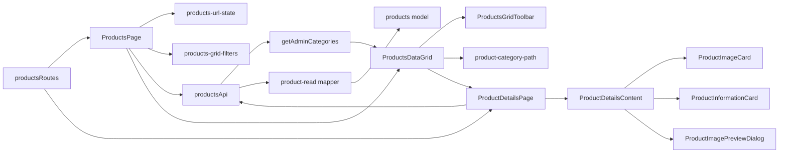

# Перегляд товарів Admin

**Стан:** реалізовані список `/catalog`, режими «Без фото» і «На сайті» й картка `/catalog/:productSlug` за [SDD перегляду](../../specs/admin/products/001-read-only-product-browsing/README.md). Backend OpenAPI snapshot і generated types синхронізовано. Історія початкової таблиці — в [попередній SDD](../../specs/admin/products/product-list-data-grid.md).

- **Вхід:** [productsRoutes](../../../libs/admin/products/feature/src/products.routes.tsx) підключає [список](../../../libs/admin/products/feature/src/pages/products-page.tsx) і [картку](../../../libs/admin/products/feature/src/pages/product-details-page.tsx); пункт «Товари» веде на `/catalog`.
- **Список:** вкладки «Усі товари», «Без фото» і «На сайті» передають пошук, підтримувані фільтри, sort/page/pageSize на сервер. «На сайті» звертається до звичайного endpoint з `exportToSite=true`; у вкладці «Усі товари» цієї умови немає. Наявність, акція й новинка показані окремими колонками; ознаку «На сайті» представляє вкладка. Таблиця показує лише українську назву товару та повний шлях категорії від батьківської до дочірньої з довідника `GET /api/categories`. Коли категорії немає в довіднику, використовує назву зі спискового API або підпис з ID, якщо й вона порожня. Категорія має серверне сортування та відбір за вибраним піддеревом. Фото має розмір 56 × 56 px, а дія перегляду — іконка ока з підказкою. [URL-модуль](../../../libs/admin/products/feature/src/hooks/products-url-state.ts) зберігає умови й сторінку кожної вкладки для повернення з деталей.
- **UI списку:** [ProductsDataGrid](../../../libs/admin/products/ui/src/tables/products-data-grid.tsx) містить MUI toolbar із пошуком, колонкові фільтри трьох інших ознак, сортування та пагінацію без edit/delete. Довгі назви товарів і шляхи категорій переносяться на нові рядки, висота рядка підлаштовується під вміст. Під таблицею немає дубльованого підпису кількості. Таблиця зберігає доступ до всіх колонок на вузькому екрані через власне прокручування. Екрани використовують світлу й темну схеми Admin theme; підписи Data Grid локалізовані українською.
- **Картка:** [ProductDetailsPage](../../../libs/admin/products/feature/src/pages/product-details-page.tsx) керує маршрутом, API й станами та має текстове посилання зі стрілкою для повернення до активного списку. [Презентаційний вміст](../../../libs/admin/products/ui/src/components/product-details-content.tsx) на широкому екрані показує **фото → основну інформацію → схему справа**, якщо вона доступна; на телефоні й планшеті блоки складаються за breakpoints. Головний блок містить обидві назви, тільки істинні різнокольорові ознаки, таблицю даних і кнопки «Відкрити на сайті» (за `exportToSite`) та «Сховище фото». Натискання безпосередньо на фото відкриває MUI Dialog; окремої кнопки JPG немає. Композиція узгоджена зі [стандартом сторінок Admin](../../standards/admin/list-detail-pages.md). Спільний shell не показує breadcrumbs.
- **Дані:** [products API](../../../libs/admin/products/data-access/src/api/admin-products.api.ts) використовує RTK Query та [мапери](../../../libs/admin/products/data-access/src/mappers/product-read.mapper.ts). Чинні consumer contracts: [звичайний список і Admin деталі](../../contracts/catalog/admin-products.md), [без фото](../../contracts/catalog/missing-photo-products.md). Backend OpenAPI snapshot і generated types синхронізовано; [SDD-контракт](../../specs/admin/products/001-read-only-product-browsing/contracts/api-contract.md) описує правила запитів.

Вбудований [toolbar](../../../libs/admin/products/ui/src/tables/products-grid-toolbar.tsx) містить MUI Autocomplete з ієрархією категорій із `GET /api/categories`: рівні показано відступами, стрілка батьківського вузла згортає або розгортає гілку без вибору, а натискання на назву вибирає будь-який рівень. Пошук показує знайдені категорії разом із предками. Українські підписи не містять ID. Для відомих категорій [мапер](../../../libs/admin/products/data-access/src/mappers/public-category-names.uk.ts) використовує українські назви публічного каталогу; обраний ID зберігається окремо в кожній вкладці. [SDD категорії](../../specs/admin/products/001-read-only-product-browsing/category-table-2026-10-19.md) визначає вибір, сортування й межі перевірки.

## Зв'язки



## Основні файли

```text
libs/admin/products/
├── data-access/src/
│   ├── api/admin-products.api.ts        # запити звичайного списку, без фото й деталей
│   └── mappers/product-read.mapper.ts   # перевірка й проєкція нових відповідей
├── feature/src/
│   ├── hooks/products-url-state.ts      # режим, умови й сторінки в URL
│   ├── hooks/products-grid-filters.ts   # MUI filterModel ↔ серверний query
│   ├── pages/products-page.tsx          # таблиця й верхній перемикач
│   ├── pages/product-details-page.tsx   # route, API й стани картки
│   └── products.routes.tsx              # lazy маршрути
├── model/src/                         # доменні типи списку й деталей
└── ui/src/
    ├── components/                     # презентаційні блоки деталей, зображення й Dialog
    └── tables/
        ├── product-category-path.ts    # шлях категорії та fallback при відсутніх даних
        ├── products-grid-toolbar.tsx    # пошук і розгортання дерева категорій
        └── products-data-grid.tsx       # таблиця без API й router
```
