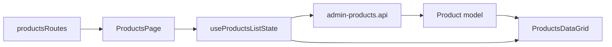

# Список товарів Admin

**Стан:** реалізований `/catalog`; вимоги й історія — у [SDD](../../specs/admin/products/product-list-data-grid.md).

- **Маршрут:** [productsRoutes](../../../libs/admin/products/feature/src/products.routes.tsx) підключає [ProductsPage](../../../libs/admin/products/feature/src/pages/products-page.tsx).
- **Поведінка:** [useProductsListState](../../../libs/admin/products/feature/src/hooks/use-products-list-state.ts) веде фільтри, сторінку й сортування; сторінка передає запит, помилку й завантаження в [ProductsDataGrid](../../../libs/admin/products/ui/src/index.ts).
- **Дані:** [admin-products.api](../../../libs/admin/products/data-access/src/api/admin-products.api.ts) виконує RTK Query запит; `data-access` мапить DTO у [модель](../../../libs/admin/products/model/src/entities/admin-product-list-item.ts). Consumer contract: [Admin products](../../contracts/catalog/admin-products.md).

## Схема будови



## Структура в коді

Фактичні точки входу й основні файли фічі (інші файли цих каталогів тут не перелічено):

```text
libs/admin/products/
├── data-access/src/api/admin-products.api.ts  # запит до API
├── feature/src/
│   ├── hooks/use-products-list-state.ts  # стан і дії екрана
│   ├── pages/products-page.tsx  # сторінка та композиція UI
│   └── products.routes.tsx  # маршрути фічі
├── model/src/entities/admin-product-list-item.ts  # доменна модель
└── ui/src/index.ts  # публічний API бібліотеки
```
