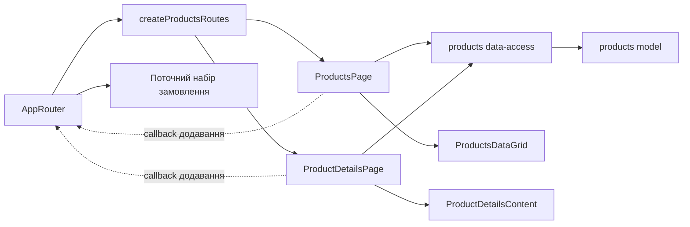

# Товари Admin

**Стан:** реалізовано. Маршрути: `/catalog` і `/catalog/:productSlug`. Вимоги та перевірки: [SDD перегляду](../../specs/admin/products/001-read-only-product-browsing/README.md); правила композиції — [Admin standard](../../standards/admin/list-detail-pages.md).

- [Список](../../../libs/admin/products/feature/src/pages/products-page.tsx) має режими «Усі товари», «Без фото» й «На сайті». [ProductsDataGrid](../../../libs/admin/products/ui/src/tables/products-data-grid.tsx) передає підтримувані пошук, фільтри, сортування й пагінацію на сервер; стан вкладок зберігається в URL.
- [Деталі](../../../libs/admin/products/feature/src/pages/product-details-page.tsx) показують дані й медіа товару та повертають до попереднього стану списку. Зі списку й деталей можна додати товар до [поточного набору замовлення](orders.md) через callback AppRouter.
- [Products data-access](../../../libs/admin/products/data-access/src/api/admin-products.api.ts) відповідає за запити і мапінг. Операції описують [контракт товарів](../../contracts/catalog/admin-products.md) і [контракт товарів без фото](../../contracts/catalog/missing-photo-products.md).

## Схема будови



## Структура в коді

```text
libs/admin/products/
├── feature/src/products.routes.tsx               # маршрути та callback додавання
├── feature/src/pages/products-page.tsx           # режими й стан списку
├── feature/src/pages/product-details-page.tsx    # деталі товару
├── data-access/src/api/admin-products.api.ts     # запити каталогу
├── data-access/src/mappers/                     # перевірка й проєкція даних
├── model/src/                                   # типи товарів і параметри
└── ui/src/                                      # таблиця й блоки деталей без HTTP
```
