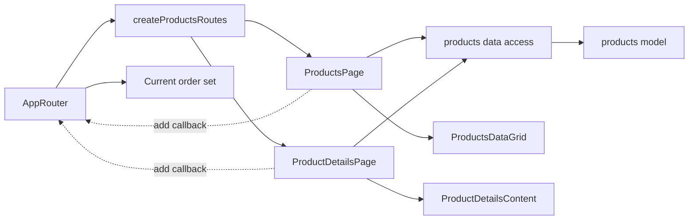

# Admin Products

**Status:** implemented. Routes: `/catalog` and `/catalog/:productSlug`. Requirements and checks: [read-only browsing SDD](../../specs/admin/products/001-read-only-product-browsing/README.md); composition rules: [Admin standard](../../standards/admin/list-detail-pages.md).

- The [list](../../../libs/admin/products/feature/src/pages/products-page.tsx) has modes “Усі товари”, “Без фото”, and “На сайті”; administrators also get “Видалені” ([DeletedProductsDataGrid](../../../libs/admin/products/ui/src/tables/deleted-products-data-grid.tsx), search and paging only). [ProductsDataGrid](../../../libs/admin/products/ui/src/tables/products-data-grid.tsx) sends supported search, filters, sorting, and pagination to the server; tab state is stored in the URL.
- [Details](../../../libs/admin/products/feature/src/pages/product-details-page.tsx) show product data, media, and the public address `/uk/product/{slug}`, and return to the previous list state. Administrators change the address with the shared `ChangeSlugDialog`; the page then moves to the new address (see [categories](categories.md)). The list and details can add a product to the [current order set](orders.md) through an AppRouter callback.
- [Products data access](../../../libs/admin/products/data-access/src/api/admin-products.api.ts) handles requests and mapping. Operations are described in the [products contract](../../contracts/catalog/admin-products.md) and [missing-photo products contract](../../contracts/catalog/missing-photo-products.md).

## Architecture



## Code structure

```text
libs/admin/products/
├── feature/src/products.routes.tsx               # routes and add callback
├── feature/src/pages/products-page.tsx           # modes and list state
├── feature/src/pages/product-details-page.tsx    # product details
├── data-access/src/api/admin-products.api.ts     # catalog requests
├── data-access/src/mappers/                     # data validation and projection
├── model/src/                                   # product types and parameters
└── ui/src/                                      # table and detail blocks without HTTP

libs/admin/shared/ui/src/                        # status pill, grid overlay, page and detail headers, cards
```

## Tests

Spec files sit next to the code in each project. Focused runs:

- `libs/admin/products/data-access` (3 spec files): `npx nx run admin-products-data-access:vite:test -- --run`
- `libs/admin/products/feature` (3 spec files): `npx nx run admin-products-feature:vite:test -- --run`
- `libs/admin/products/ui` (3 spec files): `npx nx run admin-products-ui:vite:test -- --run`
- `libs/admin/shared/ui` (2 spec files): `npx nx run admin-shared-ui:vite:test -- --run`

Without tests: `admin-products-model`.
