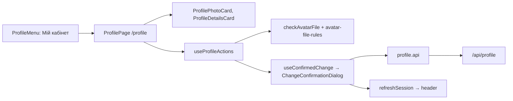

# Admin Мій кабінет

**Entry point:** `/profile`, created by [createProfileRoutes](../../../libs/admin/users/feature/src/profile.routes.tsx) inside the staff session in [AppRouter](../../../apps/admin/src/app/router/app-router.tsx); the header menu item "Мій кабінет" opens it. Every staff member (Admin or Manager) has it. SDD: [staff profile and avatars](../../specs/admin/users/001-staff-profile-and-avatars/README.md).

- [ProfilePage](../../../libs/admin/users/feature/src/pages/profile-page.tsx) shows [ProfilePhotoCard](../../../libs/admin/users/ui/src/profile/profile-photo-card.tsx) (photo, upload, remove, limits) and [ProfileDetailsCard](../../../libs/admin/users/ui/src/profile/profile-details-card.tsx) (name, email, role, password).
- A manager changes the name and photo. An admin also changes the email and password; both forms ask for the current password ([ChangeEmailDialog](../../../libs/admin/users/ui/src/profile/dialogs/change-email-dialog.tsx), [ChangePasswordDialog](../../../libs/admin/users/ui/src/profile/dialogs/change-password-dialog.tsx)).
- Forms only collect values. [useConfirmedChange](../../../libs/admin/users/feature/src/hooks/use-confirmed-change.ts) holds one pending change and sends it after "confirm" in [ChangeConfirmationDialog](../../../libs/admin/users/feature/src/components/change-confirmation-dialog.tsx); a photo shows a preview there.
- [checkAvatarFile](../../../libs/admin/users/feature/src/avatar/check-avatar-file.ts) checks type, size (≤ 2 MB) and decoded size (≥ 128×128) before upload, with the rules in [avatar-file-rules](../../../libs/admin/users/model/src/validation/avatar-file-rules.ts).
- After a change, `onProfileChanged` (the app passes `refreshSession` from `@admin/core/auth`) re-reads `me`, so the header shows the new name and photo.
- Without a photo, [UserAvatar](../../../libs/admin/shared/ui/src/lib/user-avatar.tsx) draws the first letter of the name on one of eight colours chosen by a stable hash of the name.
- Data: [profile.api](../../../libs/admin/users/data-access/src/api/profile.api.ts) (`/api/profile`, tag `StaffProfile`). Contract: [Staff profile](../../contracts/identity/profile.md).

## Architecture



## Code structure

```text
libs/admin/users/
├── model/src/
│   ├── entities/staff-profile.ts  # StaffProfile, canChangeOwnCredentials
│   └── validation/avatar-file-rules.ts  # photo limits and messages
├── data-access/src/api/profile.api.ts  # /api/profile queries and mutations
├── ui/src/
│   ├── profile/  # photo card, details card
│   ├── avatar/avatar-picker-button.tsx  # hidden file input
│   ├── profile/dialogs/  # change email, change password (own account)
│   └── dialogs/  # edit text, confirm
└── feature/src/
    ├── profile.routes.tsx  # /profile, profilePath
    ├── pages/profile-page.tsx  # page composition
    ├── hooks/use-profile-actions.ts, use-confirmed-change.ts  # flows
    └── avatar/  # checkAvatarFile, useAvatarChange
libs/admin/shared/ui/src/lib/user-avatar.tsx  # photo or coloured initial
```

## Tests

- `npx nx run admin-users-feature:vite:test -- --run` (profile page, file checks, error messages)
- `npx nx run admin-users-model:vite:test -- --run` (photo limits)
- `npx nx run admin-shared-ui:vite:test -- --run` (UserAvatar)
