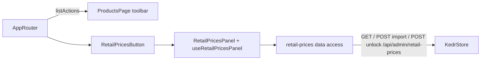

# Admin «Завантажити роздрібні ціни»

**Status:** implemented. Entry: the «Завантажити роздрібні ціни» button in the header of `/catalog` ([products](products.md)), roles with `CanManageProducts`. Backend: KedrStore spec catalog/010, operations `getAdminRetailPriceStatus`, `importAdminRetailPrices`, `unlockAdminRetailPrices` in the [contract](../../contracts/openapi/openapi.json), consumer projection [admin retail prices](../../contracts/catalog/admin-retail-prices.md). Requirements: [SDD](../../specs/admin/retail-prices/001-retail-price-file/README.md).

- Until 1C sends prices in their currency, the owner uploads the 1C price list saved as Excel (.xlsx, up to 10 MB). Only the site retail price type («Розница халтмаг 30%») changes, matched by the «Код» column.
- The right panel «Роздрібні ціни з файлу» shows which price type the site uses and, only when there are some, how many prices 1C does not update now.
- The checkbox «Не оновлювати з 1С ціни, завантажені файлом» is on by default: the prices from the file stay until the owner returns them. Products missing from the file keep getting prices from 1C.
- After upload: «Змінено: N · Без змін: N», and warnings for codes not found and rows without a price (the first codes and «і ще N»).
- «Повернути ціни під 1С» asks for confirmation and gives every locked price back to the 1C sync.
- Errors are shown in Ukrainian: wrong file, file too large (413), a 1C price sync running at the same moment (409, try again).

## Architecture



`products/feature` does not import the retail prices domain: the app passes the button through the `listActions` option of the products routes. A successful upload or unlock invalidates the `RetailPrices` and `Products` tags.

## Code structure

```text
libs/admin/retail-prices/
├── data-access/src/api/admin-retail-prices.api.ts        # status query, import (multipart) and unlock mutations
├── data-access/src/contracts/retail-prices.contract.ts   # DTOs from the OpenAPI types
├── feature/src/hooks/use-retail-prices-panel.ts          # file, checkbox, upload, unlock, result, error, notice
├── feature/src/model/retail-price-text.ts                # Ukrainian texts: locked line, codes, errors
└── feature/src/components/                               # button, panel, status, upload form, result
```

## Tests

- `npx nx run admin-retail-prices-data-access:vite:test -- --run` — form body and tags.
- `npx nx run admin-retail-prices-feature:vite:test -- --run` — texts, controller, status, upload, result, panel, button.
- `npx nx run admin-products-feature:vite:test -- --run` — the header shows the actions the app gives.
- `apps/stack-e2e/src/admin/retail-prices.spec.ts` (CI, full stack) — upload of `fixtures/retail-prices.xlsx`, unknown code, lock line, return to 1C.
