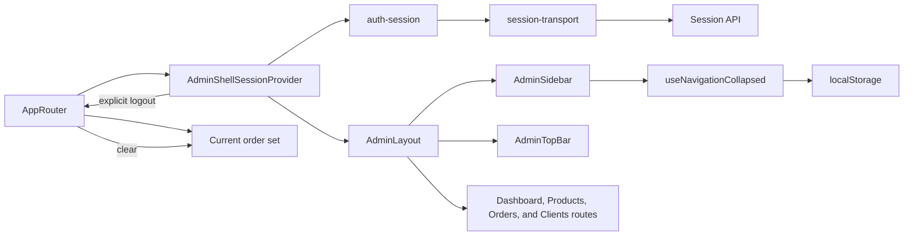

# Admin Session and Shell

**Entry point:** [AppRouter](../../../apps/admin/src/app/router/app-router.tsx) wraps the routes in [AdminShellSessionProvider](../../../libs/admin/core/shell/src/providers/admin-shell-session-provider.tsx) and `AdminLayout`.

- [auth-session](../../../libs/admin/core/auth/src/session/auth-session.ts) initializes, refreshes, and ends the session; [session-transport](../../../libs/admin/core/auth/src/session/session-transport.ts) calls the session API. See the [contract](../../contracts/identity/session.md).
- [AdminLayout](../../../libs/admin/core/shell/src/admin-layout.tsx) and navigation belong to `core/shell`; dashboard, products, orders, and clients connect their routes through [AppRouter](../../../apps/admin/src/app/router/app-router.tsx). There is no `/login` route. AppRouter clears the local order product set on explicit sign-out; `auth-session` performs server logout.
- [AdminSidebar](../../../libs/admin/core/shell/src/components/layout/admin-sidebar.tsx) holds the logo, navigation, and current order card. On `lg` and up it sits in a permanent drawer that collapses to icons (264 ↔ 84 px); [useNavigationCollapsed](../../../libs/admin/core/shell/src/components/navigation/use-navigation-collapsed.ts) remembers the choice in `localStorage`. Below `lg` it opens as a temporary drawer. Visual rules: [design system](../../standards/admin/design-system.md); SDD: [redesign 001](../../specs/admin/redesign/001-design-system-and-shell/README.md).

## Architecture



## Code structure

Actual entry points and primary feature files (other files in these directories are omitted):

```text
apps/admin/src/app/
└── router/app-router.tsx  # route entry point

libs/admin/core/auth/
└── src/session/
    ├── auth-session.ts  # feature implementation
    └── session-transport.ts  # feature implementation

libs/admin/core/shell/
└── src/
    ├── components/
    │   ├── layout/admin-sidebar.tsx  # logo, navigation, current order, collapse control
    │   ├── navigation/admin-navigation.tsx  # section links, collapsed rendering
    │   ├── navigation/use-navigation-collapsed.ts  # remembered collapsed state
    │   └── top-bar/admin-top-bar.tsx  # top bar actions
    ├── providers/admin-shell-session-provider.tsx  # feature implementation
    └── admin-layout.tsx  # drawers and content offset

apps/admin/src/app/theme/  # design system tokens: palette, typography, shadows, motion, components
```

## Tests

Spec files sit next to the code in each project. Focused runs:

- `apps/admin` (3 spec files): `npx nx run admin:vite:test -- --run`
- `libs/admin/core/shell` (2 spec files): `npx nx run admin-core-shell:vite:test -- --run`

Without tests: `admin-core-auth`.
