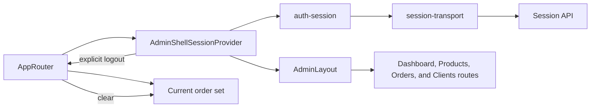

# Admin Session and Shell

**Entry point:** [AppRouter](../../../apps/admin/src/app/router/app-router.tsx) wraps the routes in [AdminShellSessionProvider](../../../libs/admin/core/shell/src/providers/admin-shell-session-provider.tsx) and `AdminLayout`.

- [auth-session](../../../libs/admin/core/auth/src/session/auth-session.ts) initializes, refreshes, and ends the session; [session-transport](../../../libs/admin/core/auth/src/session/session-transport.ts) calls the session API. See the [contract](../../contracts/identity/session.md).
- [AdminLayout](../../../libs/admin/core/shell/src/admin-layout.tsx) and navigation belong to `core/shell`; dashboard, products, orders, and clients connect their routes through [AppRouter](../../../apps/admin/src/app/router/app-router.tsx). There is no `/login` route. AppRouter clears the local order product set on explicit sign-out; `auth-session` performs server logout.

## Architecture



## Code structure

Actual entry points and primary feature files (other files in these directories are omitted):

```text
apps/admin/src/app/
└── router/app-router.tsx  # route entry point

libs/admin/core/auth/
└── src/session/
    ├── auth-session.ts  # feature implementation
    └── session-transport.ts  # feature implementation

libs/admin/core/shell/
└── src/
    ├── providers/admin-shell-session-provider.tsx  # feature implementation
    └── admin-layout.tsx  # feature implementation
```
