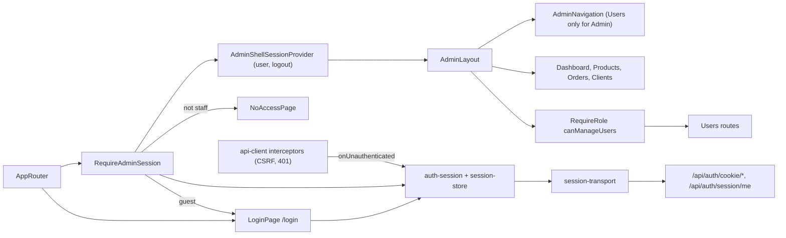

# Admin Session and Shell

**Entry point:** [AppRouter](../../../apps/admin/src/app/router/app-router.tsx) opens `/login` and wraps every other route in `RequireAdminSession`, [AdminShellSessionProvider](../../../libs/admin/core/shell/src/providers/admin-shell-session-provider.tsx), and `AdminLayout`.

- The browser session is an HttpOnly cookie set by `POST /api/auth/cookie/login`; JavaScript never sees a token. [session-transport](../../../libs/admin/core/auth/src/session/session-transport.ts) signs in, reads `GET /api/auth/session/me`, and signs out with the CSRF header. [auth-session](../../../libs/admin/core/auth/src/session/auth-session.ts) keeps the result in [session-store](../../../libs/admin/core/auth/src/session/session-store.ts). See the [contract](../../contracts/identity/session.md).
- Without a session, [RequireAdminSession](../../../libs/admin/core/auth/src/routes/require-admin-session.tsx) sends the user to [LoginPage](../../../libs/admin/core/auth/src/pages/login-page.tsx) with `?returnTo=` and the page returns there after sign-in ([login-return-path](../../../libs/admin/core/auth/src/routes/login-return-path.ts) accepts only in-app paths). A signed-in account without the Admin or Manager role sees the full-screen [NoAccessPage](../../../libs/admin/core/auth/src/pages/no-access-page.tsx).
- Any API `401` (session expired, password changed, account blocked) sets the session to anonymous through the API client's `onUnauthenticated`, which opens the login page. Every non-GET request carries `X-CSRF-Token` from the `kedr.csrf` cookie ([csrf-request interceptor](../../../libs/admin/shared/api-client/src/interceptors/csrf-request.interceptor.ts)).
- Role-gated sections use the layout route [RequireRole](../../../libs/admin/core/auth/src/routes/require-role.tsx), which shows "Немає доступу" inside the layout. The shell receives an `AdminShellUser` from the app ([shell-user](../../../apps/admin/src/app/router/shell-user.ts)): navigation shows **Користувачі** only when `canManageUsers`, and the profile menu shows the name, email, and role. The backend still enforces every policy.
- [AdminLayout](../../../libs/admin/core/shell/src/admin-layout.tsx) and navigation belong to `core/shell`; dashboard, products, orders, clients, and [users](users.md) connect their routes through AppRouter. AppRouter clears the local order product set on explicit sign-out.
- [AdminSidebar](../../../libs/admin/core/shell/src/components/layout/admin-sidebar.tsx) holds the logo, navigation, and current order card. On `lg` and up it sits in a permanent drawer that collapses to icons (264 ↔ 84 px); [useNavigationCollapsed](../../../libs/admin/core/shell/src/components/navigation/use-navigation-collapsed.ts) remembers the choice in `localStorage`. Below `lg` it opens as a temporary drawer. Visual rules: [design system](../../standards/admin/design-system.md); SDD: [redesign 001](../../specs/admin/redesign/001-design-system-and-shell/README.md).

## Architecture



## Code structure

Actual entry points and primary feature files (other files in these directories are omitted):

```text
apps/admin/src/app/router/
├── app-router.tsx  # login route, session guard, role-gated users route
└── shell-user.ts  # maps the session user to the shell's AdminShellUser

libs/admin/core/auth/src/
├── pages/
│   ├── login-page.tsx  # email/password form, return to the previous page
│   ├── login-error-message.ts  # 401/429/offline messages
│   └── no-access-page.tsx  # full-screen or in-layout "no access"
├── routes/
│   ├── login-return-path.ts  # safe returnTo handling
│   ├── require-admin-session.tsx  # guest → login, non-staff → no access
│   └── require-role.tsx  # layout route for role-gated sections
└── session/
    ├── auth-session.ts  # login, logout, bootstrap
    ├── session-store.ts  # loading/anonymous/authenticated state
    ├── session-transport.ts  # cookie session HTTP calls
    ├── session-user.ts  # roles: isStaff, canManageUsers
    └── use-admin-session.ts  # React hook

libs/admin/shared/api-client/src/
├── csrf/csrf-token.ts  # reads kedr.csrf
└── interceptors/
    ├── csrf-request.interceptor.ts  # X-CSRF-Token on unsafe methods
    └── unauthorized.interceptor.ts  # 401 → onUnauthenticated

libs/admin/core/shell/src/
├── components/
│   ├── layout/admin-sidebar.tsx  # logo, navigation, current order, collapse control
│   ├── navigation/admin-navigation.tsx  # section links by role, collapsed rendering
│   ├── navigation/use-navigation-collapsed.ts  # remembered collapsed state
│   └── top-bar/profile-menu.tsx  # user name, role, sign-out
├── providers/admin-shell-session-provider.tsx  # user and logout for the shell
└── admin-layout.tsx  # drawers and content offset

apps/admin/src/app/theme/  # design system tokens: palette, typography, shadows, motion, components
```

## Tests

Spec files sit next to the code in each project. Focused runs:

- `libs/admin/core/auth` (4 spec files: login page, session guard, role guard, return path): `npx nx run admin-core-auth:vite:test -- --run`
- `libs/admin/core/shell` (3 spec files, including navigation by role): `npx nx run admin-core-shell:vite:test -- --run`
- `apps/admin` (3 spec files): `npx nx run admin:vite:test -- --run`
