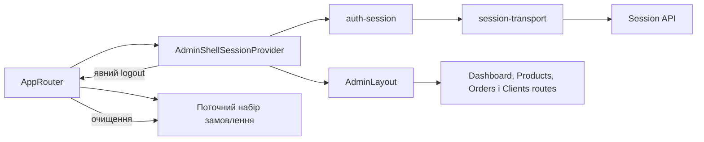

# Сесія й оболонка Admin

**Вхід:** [AppRouter](../../../apps/admin/src/app/router/app-router.tsx) обгортає маршрути в [AdminShellSessionProvider](../../../libs/admin/core/shell/src/providers/admin-shell-session-provider.tsx) та `AdminLayout`.

- [auth-session](../../../libs/admin/core/auth/src/session/auth-session.ts) ініціалізує, оновлює та завершує сесію; [session-transport](../../../libs/admin/core/auth/src/session/session-transport.ts) викликає session API. [Контракт](../../contracts/identity/session.md).
- [AdminLayout](../../../libs/admin/core/shell/src/admin-layout.tsx) і навігація належать `core/shell`; dashboard, products, orders і clients підключають свої маршрути через [AppRouter](../../../apps/admin/src/app/router/app-router.tsx). Власного маршруту `/login` немає. AppRouter очищує локальний набір товарів замовлення при явному виході; серверний logout виконує `auth-session`.

## Схема будови



## Структура в коді

Фактичні точки входу й основні файли фічі (інші файли цих каталогів тут не перелічено):

```text
apps/admin/src/app/
└── router/app-router.tsx  # точка входу маршруту

libs/admin/core/auth/
└── src/session/
    ├── auth-session.ts  # реалізація фічі
    └── session-transport.ts  # реалізація фічі

libs/admin/core/shell/
└── src/
    ├── providers/admin-shell-session-provider.tsx  # реалізація фічі
    └── admin-layout.tsx  # реалізація фічі
```
