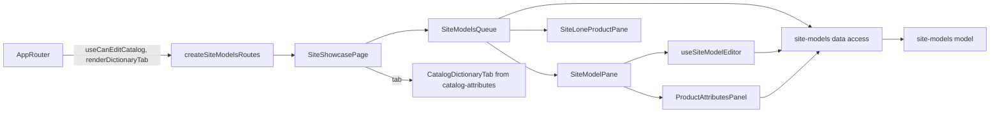

# Admin «Вітрина сайту»

**Status:** implemented (stages 4–4c of the backend site models specification, KedrStore `docs/sdd/specs/catalog/007-*`). Route: `/site-showcase` with tabs «Моделі», «Ознаки» (`?tab=attributes`), «Не розшифровані коди» (`codes`), «Фільтри категорій» (`filters`); menu «Каталог → Вітрина сайту». The old `/site-models`, `/site-models/:id` and `/catalog-attributes` addresses redirect here. Managers and administrators; the dictionary tabs are on [«Ознаки»](catalog-attributes.md). Composition rules: [Admin standard](../../standards/admin/list-detail-pages.md).

A model is one site page in one final category that brings together products of that category; its axes (color, size, side) are the switchers that tell the products apart. Automation proposes models after each 1C sync; a person reviews every proposal one by one (no bulk accept, owner 2026-11-05) or creates a model. «Товари» stays the 1C list and shows nothing about models.

- On site means exported from 1C, not deleted, and in a category shown on the site (the Admin mark on [«Категорії»](categories.md)). A product of a proposed model waits for review; only a product in no model at all is the hard error «Немає моделі».
- **Моделі** ([queue](../../../libs/admin/site-models/feature/src/components/queue/site-models-queue.tsx), canvas variant B): a toolbar with the [category picker](../../../libs/admin/site-models/ui/src/components/pickers/site-category-picker.tsx) (the tree of shown categories in a popover), the views «Усі · N / На перевірку · N / З проблемами · N / Без моделі · N» (counts from the category tree; «Без моделі» only while there are such; «Усі» opens by default) and a search. On the left the [queue list](../../../libs/admin/site-models/ui/src/components/navigation/site-queue-list.tsx): names only, no photos, a blue dot for a proposal, amber for problems, red for a product in no model; ↑ and ↓ move through it. The view, category, search and open row live in the address (`view`, `categoryId`, `search`, `item=m{id}|p{id}`), so «Огляд» links straight to a view.
- **Model pane** ([SiteModelPane](../../../libs/admin/site-models/feature/src/components/model-pane/site-model-pane.tsx)) beside the queue: name with «Не перевірена» for a proposal, rename in place (the slug stays), problems; tabs «Товари й ознаки» (products as rows: a large photo, the full name, a value picker per axis, «Чого бракує»; no price; «Усі ознаки» opens the [attributes panel](../../../libs/admin/site-models/feature/src/components/product-pane/product-attributes-panel.tsx), «Прибрати», «Заповнити з назв», «Додати товар» in the [right panel](../../../libs/admin/site-models/ui/src/panels/add-model-products-panel.tsx); similar proposals of the category with «Об’єднати сюди»; axes and characteristics). Pickers search by name ([CreatablePicker](../../../libs/admin/site-models/ui/src/components/pickers/creatable-picker.tsx)): a name nothing matches offers «Створити ознаку» in «Чим відрізняються товари» (a list attribute that is a site filter and a switcher, added to the model at once) and «Створити значення» in a product row (the value is added to the axis and set on the product), so everything is set up on one page and «SEO та опис» (texts in Ukrainian and Russian with counters and a Google preview). The footer has «Пропустити» and «Погодити і далі» for a proposal, «Далі» for an accepted model.
- **Product in no model** ([pane](../../../libs/admin/site-models/feature/src/components/product-pane/site-lone-product-pane.tsx)): photo, values, problems, «Усі ознаки товару», and «Створити модель» with its name; to add it to an existing model, open that model and use «Додати товар».
- Problem codes and their Ukrainian names are in [site-model-problem](../../../libs/admin/site-models/model/src/entities/models/site-model-problem.ts); the queue views, counts and similar models are in [site-queue](../../../libs/admin/site-models/model/src/entities/showcase/site-queue.ts). Only problems are marked.
- Requests are in [site models data access](../../../libs/admin/site-models/data-access/src/api/site-models.api.ts) and [product attributes data access](../../../libs/admin/site-models/data-access/src/api/product-attributes.api.ts) under the tag `SiteModels`; every change refreshes all site models data. Operations are in the [site models contract](../../contracts/openapi/catalog/site-models.openapi.yaml). The «Огляд» lines are in [dashboard](dashboard.md).

## Architecture



## Code structure

```text
libs/admin/site-models/
├── feature/src/site-models.routes.tsx       # the page and the redirects of the old addresses
├── feature/src/pages/site-showcase-page.tsx # tabs; «Нова ознака» beside them
├── feature/src/components/                  # queue, model pane, product in no model, attributes panel
├── feature/src/hooks/                       # model editor, axis value options, attributes editor
├── feature/src/model/site-showcase-url-state.ts # tab and queue in the address, old addresses
├── feature/src/errors/                      # Ukrainian error messages
├── data-access/src/api/                     # site models and product attributes requests
├── data-access/src/{mappers,validators}/    # zod schemas, DTO → model, request bodies
├── model/src/entities/                      # model, showcase, category tree, queue, problems, product attributes
└── ui/src/                                  # queue, category picker and tree, model card blocks, panels
```

## Tests

- `npx nx run admin-site-models-model:vite:test -- --run` — texts by language, problems, queue views and counts, similar models.
- `npx nx run admin-site-models-data-access:vite:test -- --run` — showcase and card mapping, query and text bodies, attributes mapper.
- `npx nx run admin-site-models-ui:vite:test -- --run` — axis value picker, texts save and preview, attributes and review cards.
- `npx nx run admin-site-models-feature:vite:test -- --run` — address and old addresses, the queue (open, «Погодити і далі», «Об’єднати сюди», SEO tab), error messages.
