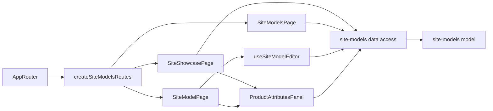

# Admin site models («Вітрина сайту», «Моделі»)

**Status:** implemented (stage 4 of the backend site models specification, KedrStore `docs/sdd/specs/catalog/007-*`). Routes: `/site-showcase`, `/site-models`, `/site-models/:id`; menu «Каталог → Вітрина сайту», «Моделі». Managers and administrators. Composition rules: [Admin standard](../../standards/admin/list-detail-pages.md).

A model is one site page in one final category that brings together products of that category; its axes (color, size, side) are the switchers that tell the products apart. Automation proposes models after each 1C sync; a person accepts or creates them. «Товари» stays the 1C list and shows nothing about models.

- On site means exported from 1C, not deleted, and in a category shown on the site (the Admin mark on [«Категорії»](categories.md)); both lists, the model card and the category tree show nothing else. Neither table has row checkboxes (owner, 2026-11-05).
- **Category tree** ([SiteModelCategoriesNav](../../../libs/admin/site-models/ui/src/categories/site-model-categories-nav.tsx)) beside both tables: MUI X `SimpleTreeView` of shown categories with on-site products; the arrow collapses and expands, a click selects a category with its subcategories (`categoryId` in the address), counts include subcategories, a red count marks problems.
- **Вітрина сайту** ([page](../../../libs/admin/site-models/feature/src/pages/site-showcase-page.tsx)): one row per model (and per on-site product in no model) with photo, price «від», stock and «Чого бракує»; the arrow or a click on the row shows the model's products with their variant values and problems. Rows with «Немає моделі» come first. Tiles above the table count problems and filter it; the search, category and problem filters live in the address (`categoryId`, `problem`, `search`, `page`, `pageSize`), so «Огляд» links straight to `?problem=no_model`. «Відкрити» goes to the model card. The pencil opens the [attributes panel](../../../libs/admin/site-models/feature/src/components/product-attributes-panel.tsx): values, «Повернути автоматичне», the original 1C name read-only, and the review («Прийняти як є» / «Повернути на перевірку»).
- **Моделі** ([page](../../../libs/admin/site-models/feature/src/pages/site-models-page.tsx)): the category tree with model counts; tabs «Усі / Прийняті / Запропоновані»; a banner offers the proposals, which are accepted one by one in the card; a click on a row opens the card (also on narrow screens, where «Дії» scrolls away); «Нова модель» creates an empty accepted model in the selected final category; «Як це працює» explains the idea.
- The card goes back to the list it came from with its filters ([site-list-return](../../../libs/admin/site-models/feature/src/model/site-list-return.ts), passed in the navigation state), so a save in the card does not lose the chosen category.
- **Model card** ([page](../../../libs/admin/site-models/feature/src/pages/site-model-page.tsx)): problems banner; products with a value picker per axis (an empty value of an on-site product is red), «Усі ознаки», «Прибрати з моделі», «Заповнити з назв», «Додати товар» (on-site products of the category outside accepted models); axes as chips with «Додати ознаку» (number attributes are not offered); characteristics shared by all products; SEO and descriptions in Ukrainian and Russian with counters and a Google preview; rename (the slug stays) and «Прийняти модель» for a proposal.
- Problem codes and their Ukrainian names are in [site-model-problem](../../../libs/admin/site-models/model/src/entities/site-model-problem.ts); only problems are marked, and «Немає моделі» is the hard error.
- Requests are in [site models data access](../../../libs/admin/site-models/data-access/src/api/site-models.api.ts) and [product attributes data access](../../../libs/admin/site-models/data-access/src/api/product-attributes.api.ts) under the tag `SiteModels`; every change refreshes all site models data. Operations are in the [site models contract](../../contracts/openapi/catalog/site-models.openapi.yaml). The dictionary of attributes is on [«Ознаки»](catalog-attributes.md); the «Огляд» lines are in [dashboard](dashboard.md).

## Architecture



## Code structure

```text
libs/admin/site-models/
├── feature/src/site-models.routes.tsx       # three routes
├── feature/src/pages/                       # showcase, models list, model card
├── feature/src/components/                  # filters, health tiles, attributes panel and section
├── feature/src/hooks/                       # address query, model editor, axis value options, attributes editor
├── feature/src/model/site-models-url-state.ts # filters in the address
├── feature/src/model/site-list-return.ts      # where the model card goes back to
├── feature/src/errors/                      # Ukrainian error messages
├── data-access/src/api/                     # site models and product attributes requests
├── data-access/src/{mappers,validators}/    # zod schemas, DTO → model, request bodies
├── model/src/entities/                      # model, showcase item, category, health, problems, product attributes
└── ui/src/                                  # grids, categories nav, model card blocks, dialogs, attributes cards
```

## Tests

- `npx nx run admin-site-models-model:vite:test -- --run` — texts by language, problem list and names, attribute values text.
- `npx nx run admin-site-models-data-access:vite:test -- --run` — showcase and card mapping, query and text bodies, attributes mapper.
- `npx nx run admin-site-models-ui:vite:test -- --run` — axis value picker, texts save and preview, attributes and review cards.
- `npx nx run admin-site-models-feature:vite:test -- --run` — filters in the address, error messages.
