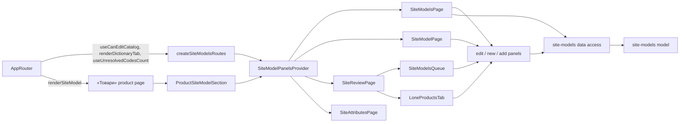

# Admin site models: «Моделі», «Перевірка», «Ознаки та фільтри»

**Status:** implemented 2026-11-26 ([SDD 001](../../specs/admin/site-models/001-showcase-pages/README.md); backend KedrStore `docs/sdd/specs/catalog/007-*`, stage 9). Routes: `/site-models` (list), `/site-models/:id` (model page), `/site-review` («Перевірка», `?tab=new|lone|codes`), `/site-attributes` («Ознаки та фільтри», [dictionary tabs](catalog-attributes.md)); menu «Каталог → Моделі / Перевірка / Ознаки та фільтри». Managers and administrators. Composition rules: [Admin standard](../../standards/admin/list-detail-pages.md).

A model is one site page that brings together products that differ by color, size or side; its axes are the switchers. A model has its own site category (a final one): every product of the model is shown there, while 1C and «Товари» keep each product's 1C category; the admin does not show it on the model (owner, 2026-11-26). Automation proposes models after each 1C sync; a person reviews each proposal one by one (no bulk accept) or creates a model by hand from products of any 1C category.

- **Моделі** ([page](../../../libs/admin/site-models/feature/src/pages/site-models-page.tsx)): a server-paged [Data Grid](../../../libs/admin/site-models/ui/src/tables/models-grid/site-models-data-grid.tsx) of all models — an arrow that opens the model's products under its row with their switcher pickers and «Усі ознаки» to fix a value on the spot, photo, name with «Не перевірена» for a proposal, site category as a full path, products on the site, switchers, «Чого бракує» (empty when nothing is missing), eye and pencil. The [toolbar](../../../libs/admin/site-models/ui/src/tables/models-toolbar/site-models-grid-toolbar.tsx) has the search, the category tree, status and «Чого бракує» filters; all of it and the open panel live in the address ([list URL state](../../../libs/admin/site-models/model/src/queries/site-model-list-url.ts)). «+ Нова модель» in the header.
- **Model page** ([page](../../../libs/admin/site-models/feature/src/pages/site-model-page.tsx)): read-only main card with its fields in a row of four (category, products, switchers, problems), then tabs, one shown at a time ([sections](../../../libs/admin/site-models/feature/src/components/model-page/site-model-sections.tsx), owner 2026-11-26): «Товари (N)» (products with inline axis value pickers — the owner-accepted exception — «Додати товар», «Прибрати», «Заповнити з назв»), «Характеристики», «SEO та опис» (UK and RU side by side); «Редагувати» and, for a proposal, «Погодити».
- **Shared panels** ([provider](../../../libs/admin/site-models/feature/src/components/panels/site-model-panels-provider.tsx), `useSiteModelPanels`): «Редагування моделі» (name, site category of final categories with the note that all products move and a proposal is accepted, switchers, SEO UK/RU, each block saving on its own), «Нова модель» (name, category, products of the whole catalog with «Вільні (без моделі) / Усі товари», a product of another accepted model locked with «Уже в моделі «…»»), «Додати в модель» (products for a model, or a model for a product). Every page opens the same panels: «Моделі», the model page, «Перевірка» (including «Додати товар» in «Нові моделі»), and the product page in «Товари» through [ProductSiteModelSection](../../../libs/admin/site-models/feature/src/components/product-model/product-site-model-section.tsx) («Модель на сайті»). The open panel is in `?panel=`.
- **Перевірка** ([page](../../../libs/admin/site-models/feature/src/pages/site-review-page.tsx)): «Нові моделі · N» is the one-by-one [review queue](../../../libs/admin/site-models/feature/src/components/queue/site-models-queue.tsx) of proposals («Погодити і далі», «Пропустити», «Об’єднати сюди», SEO tab); «Товари без моделі · N» is a [table](../../../libs/admin/site-models/ui/src/tables/lone-products/lone-products-grid.tsx) where each row has a model picker prefilled with a similar model of its category ([similarModelForProduct](../../../libs/admin/site-models/model/src/entities/showcase/lone-product-model.ts)) and «Додати», and «Нова модель»; «Коди з 1С · N» is the dictionary's codes tab.
- **Ознаки та фільтри** ([page](../../../libs/admin/site-models/feature/src/pages/site-attributes-page.tsx)): «Ознаки» and «Фільтри категорій» from [catalog attributes](catalog-attributes.md), «Нова ознака» for administrators.
- Old addresses ([site-legacy-paths](../../../libs/admin/site-models/feature/src/model/site-legacy-paths.ts)): `/site-showcase` with its views, tabs and open row, and `/catalog-attributes`, redirect to the matching new page; «Огляд» links point to the new pages.
- Problem codes and Ukrainian names are in [site-model-problem](../../../libs/admin/site-models/model/src/entities/models/site-model-problem.ts). Requests are in [site models data access](../../../libs/admin/site-models/data-access/src/api/site-models.api.ts) and [product attributes data access](../../../libs/admin/site-models/data-access/src/api/product-attributes.api.ts) under the tag `SiteModels`; every change refreshes all site models data. Operations: [contract](../../contracts/openapi/openapi.json) (`getAdminSiteModels`, `changeAdminSiteModelCategory`, …).

## Architecture



## Code structure

```text
libs/admin/site-models/
├── feature/src/site-models.routes.tsx   # pages in the panels provider; old addresses
├── feature/src/pages/                   # «Моделі», model page, «Перевірка», «Ознаки та фільтри»
├── feature/src/components/panels/       # shared panels and their provider
├── feature/src/components/{model-page,model-pane,queue,review,product-model,product-pane}/
├── feature/src/hooks/{lists,panels,model-editor}/  # list and queue controllers, panel and editor hooks
├── feature/src/model/                   # old addresses, review tab, dictionary tabs
├── data-access/src/{api,mappers,validators}/
├── model/src/{entities,mappers,queries}/  # model, list row, queue, candidates, final categories, URL states
└── ui/src/{tables,panels,details,components,dialogs,forms}/
```

## Tests

- `npx nx run admin-site-models-model:vite:test -- --run` — list and panel URL state, candidates, final categories, queue, similar model, problems.
- `npx nx run admin-site-models-data-access:vite:test -- --run` — list and card mapping with `oneCCategories`, query and text bodies.
- `npx nx run admin-site-models-ui:vite:test -- --run` — models grid and toolbar, lone products grid and picker, panels' forms, model card blocks.
- `npx nx run admin-site-models-feature:vite:test -- --run` — pages, panels and provider, routes and old addresses, queue, lone products tab, product block.
- `npx nx run admin-products-feature:vite:test -- --run` — the «Модель на сайті» slot on the product page; `npx nx run admin-core-shell:vite:test -- --run` — menu; `npx nx run admin-dashboard-model:vite:test -- --run` — «Огляд» links.
- E2E: `apps/stack-e2e/src/admin/site-model.spec.ts` (a model created from «Товари без моделі»).
