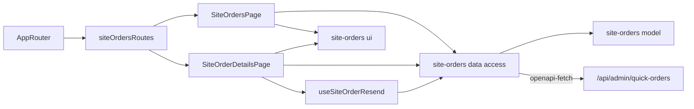

# Admin «Замовлення з сайту»

**Status:** implemented 2026-11-24. Routes: `/site-orders` and `/site-orders/:orderId`, menu «Продаж» → «Замовлення з сайту». Requirements and checks: [SDD admin/site-orders 001](../../specs/admin/site-orders/001-site-orders-list/README.md); backend: KedrStore spec `sales/009-site-orders-in-admin`; [consumer contract](../../contracts/sales/admin-site-orders.md).

A buyer without an account sends a name, a phone and the cart from the site ([site cart](../site/cart.md)). The backend keeps every such order and sends it to the managers' Telegram chat. This page lists those orders, opens one to see who ordered what, shows when Telegram has not got it and why, and sends a failed one again.

- The [list](../../../libs/admin/site-orders/feature/src/pages/site-orders-page.tsx) is a server-paged Data Grid, newest first: «Номер» (`№ 52992220`, the number the site shows after sending and Telegram puts in bold), «Дата» (Kyiv time), «Ім’я», «Телефон», «Товарів», «Сума, грн», «Telegram», «Дії». The toolbar has search by order number, name or phone (the number with or without `№`, or a whole id) and the switch «Лише з проблемою» (`delivery=problem`). Page, page size, search and the switch live in the URL.
- The «Telegram» cell is empty for a delivered order. A waiting order with an error shows a warning chip «Не надіслано» (the server still retries), a failed order an error chip; the reason is in the tooltip. The rules are in [`siteOrderDeliveryIssue`](../../../libs/admin/site-orders/model/src/mappers/site-order-delivery.ts).
- The [detail page](../../../libs/admin/site-orders/feature/src/pages/site-order-details-page.tsx) is read-only: main card (name, date, phone as a `tel:` link, total, Telegram time, order number, and the buyer comment when there is one), the problem `Alert` with the error text and the last attempt, and the lines table with the total. No «Редагувати».
- A failed order has «Надіслати в Telegram ще раз» in the header. The [resend controller](../../../libs/admin/site-orders/feature/src/hooks/use-site-order-resend.ts) locks it while the request runs; 202 refreshes the order and the list (cache tag `AdminSiteOrders`) and shows «Замовлення поставлено в чергу на відправку»; 409 shows the server text and reloads the order; 404 says «Замовлення не знайдено».
- The server retries a failed Telegram delivery for about 7 hours in the scheduled «Досилання повідомлень» task, which must be on in «Фонові задачі»; only after that an order becomes `failed`.

## Architecture



## Code structure

```text
libs/admin/site-orders/
├── feature/src/site-orders.routes.tsx                 # the two routes
├── feature/src/pages/                                 # list page (URL state), detail page (states, resend button)
├── feature/src/hooks/use-site-order-resend.ts         # resend: lock, notice, error text, reload on 409
├── data-access/src/api/admin-site-orders.api.ts       # list, detail, resend (RTK Query + typed client)
├── data-access/src/validators/site-order.schemas.ts   # response validation (zod)
├── data-access/src/mappers/site-order.mapper.ts       # validated DTO → model
├── model/src/entities/site-order.ts                   # list item, detail, line, delivery status
├── model/src/mappers/                                 # delivery problem rules, Kyiv time and money formats
├── model/src/queries/site-order-page-params.ts        # URL ↔ list parameters, order id check
├── ui/src/tables/                                     # data grid, columns, toolbar with switch, Telegram and eye cells
└── ui/src/components/                                 # detail content, main card, problem alert, lines table

libs/admin/core/shell/src/navigation/navigation-groups.tsx  # menu item in «Продаж»
apps/admin/src/app/router/app-router.tsx                     # routes in the shell
```

## Tests

Spec files sit next to the code. Focused runs:

- `npx nx run admin-site-orders-model:vite:test -- --run` (URL state, delivery rules, formats)
- `npx nx run admin-site-orders-data-access:vite:test -- --run` (mappers and validation)
- `npx nx run admin-site-orders-ui:vite:test -- --run` (grid, chips, toolbar, detail content)
- `npx nx run admin-site-orders-feature:vite:test -- --run` (list page URL, detail states, resend)
- `npx nx run admin-core-shell:vite:test -- --run` (menu item)
