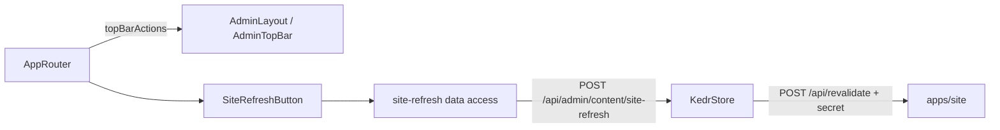

# Admin «Оновити сайт зараз»

**Status:** implemented. Entry: the round button with arrows in the top bar, on every page, all staff. Backend: KedrStore Content module, contract [site refresh](../../contracts/openapi/content/site-refresh.openapi.yaml); the site side is `POST /api/revalidate` ([rendering and caching](../../architecture/site/platform/rendering-and-caching.md#invalidation-from-the-backend)).

- The site keeps content (articles, contacts, documents, gallery, home blocks) for ten minutes and the catalogue for hours. The button asks the backend to drop both caches now, so the next visitor gets fresh pages.
- The answer is a message at the bottom: «Сайт оновлено» (200), «Сайт ще не підключено до оновлення» (503: the backend has no site address and secret yet), «Сайт не відповів» (502). In the last two cases changes still appear on their own within ten minutes.
- Every staff role may press it, as the backend policy `CanManageContent`. The button is disabled while the request runs.

## Architecture



`core/shell` does not import domains: the app passes the button through the `topBarActions` slot.

## Code structure

```text
libs/admin/site-refresh/
├── data-access/src/api/admin-site-refresh.api.ts      # refreshSite mutation
├── data-access/src/contracts/site-refresh.contract.ts # SiteRefreshResult from the OpenAPI types
├── feature/src/components/site-refresh-button.tsx     # icon button, progress, message
└── feature/src/messages/site-refresh-messages.ts      # answer → Ukrainian message (200, 503, 502, other)
```

## Tests

- `npx nx run admin-site-refresh-feature:vite:test -- --run` — success and the 503, 502 and other answers.
