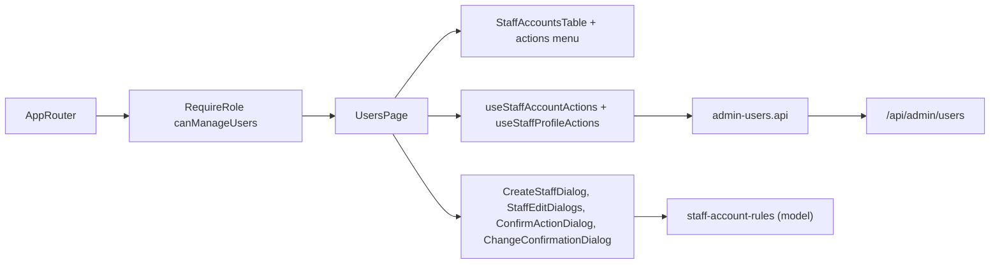

# Admin Users

**Entry point:** `/users`, created by [createUsersRoutes](../../../libs/admin/users/feature/src/users.routes.tsx) and wrapped in `RequireRole allow={canManageUsers}` in [AppRouter](../../../apps/admin/src/app/router/app-router.tsx). Only the Admin role sees the menu item and the page; a manager who opens the URL sees "Немає доступу", and the API answers `403`.

- [UsersPage](../../../libs/admin/users/feature/src/pages/users-page.tsx) lists staff accounts (Admin and Manager) with photo or coloured initial, role and status, and opens dialogs to add a user, change the role, block or unblock. For **manager** rows it also changes the name, email, password and photo; admin rows do not offer these (the API answers `403`), an admin edits their own data in [Мій кабінет](profile.md).
- [useStaffAccountActions](../../../libs/admin/users/feature/src/hooks/use-staff-account-actions.ts) holds create, role and blocking; [useStaffProfileActions](../../../libs/admin/users/feature/src/hooks/use-staff-profile-actions.ts) holds the manager edits, each confirmed in a dialog before it is sent; [staff-error-message](../../../libs/admin/users/feature/src/errors/staff-error-message.ts) turns `409` (email taken), `400` validation, and other errors into dialog messages.
- The signed-in admin cannot demote or block their own account: the menu items are disabled and the API rejects it. A role change, blocking, a new email, or a new password ends that user's sessions (cookie within 5 minutes, mobile refresh tokens at once).
- Client validation in [staff-account-rules](../../../libs/admin/users/model/src/validators/staff-account-rules.ts) mirrors the server: valid email, name required, password at least 8 characters.
- Data comes from [admin-users.api](../../../libs/admin/users/data-access/src/api/admin-users.api.ts) (`/api/admin/users`, tag `StaffAccounts`). Contract: [Staff accounts](../../contracts/identity/staff-accounts.md).

## Architecture



## Code structure

```text
libs/admin/users/
├── model/src/
│   ├── entities/staff-account.ts  # StaffAccount, roles and labels
│   └── validators/staff-account-rules.ts  # email, name, password rules
├── data-access/src/
│   ├── api/admin-users.api.ts  # list, create, role, blocked, password, name, email, avatar
│   ├── contracts/staff-account.contract.ts  # generated contract types
│   └── mappers/staff-account.mapper.ts  # DTO → StaffAccount
├── ui/src/
│   ├── tables/staff-accounts-table.tsx  # list with avatar, role and status
│   ├── tables/staff-account-actions-menu.tsx  # per-row actions; profile edits for managers only
│   └── dialogs/  # create, set password, edit text, confirm
└── feature/src/
    ├── users.routes.tsx  # /users route
    ├── pages/users-page.tsx  # page composition
    ├── hooks/use-staff-account-actions.ts  # create, role, block
    ├── hooks/use-staff-profile-actions.ts  # manager name, email, password, photo
    ├── components/  # edit dialogs, change confirmation, success snackbar
    └── errors/staff-error-message.ts  # API error → message
```

## Tests

- `admin-users-model`: `npx nx run admin-users-model:vite:test -- --run`
- `admin-users-ui` (table and create dialog): `npx nx run admin-users-ui:vite:test -- --run`
- `admin-users-feature` (error messages): `npx nx run admin-users-feature:vite:test -- --run`
