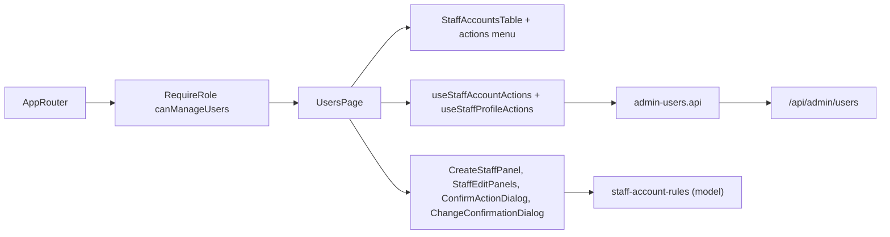

# Admin Users

**Entry point:** `/users`, created by [createUsersRoutes](../../../libs/admin/users/feature/src/users.routes.tsx) and wrapped in `RequireRole allow={canManageUsers}` in [AppRouter](../../../apps/admin/src/app/router/app-router.tsx). Only the Admin role sees the menu item and the page; a manager who opens the URL sees "Немає доступу", and the API answers `403`.

- [UsersPage](../../../libs/admin/users/feature/src/pages/users-page.tsx) lists staff accounts (Admin, SEO specialist `Seo`, and Manager) with photo or coloured initial, role and status, and opens the right edit panel to add a user (tabs «Новий» for a new account and «З бази» for an existing one), dialogs to change the role, block or unblock. The role menu offers every other role. For **manager** and **SEO specialist** rows it also changes the name, email, password and photo; admin rows do not offer these (the API answers `403`), an admin edits their own data in [Мій кабінет](profile.md).
- [useStaffAccountActions](../../../libs/admin/users/feature/src/hooks/staff/use-staff-account-actions.ts) holds create, staff access for an existing account, role and blocking; [useStaffProfileActions](../../../libs/admin/users/feature/src/hooks/staff/use-staff-profile-actions.ts) holds the manager edits, each confirmed in a dialog before it is sent; [staff-error-message](../../../libs/admin/users/feature/src/errors/staff-error-message.ts) turns `409` (email taken), `400` validation, and other errors into dialog messages.
- **«З бази»** gives staff access to an account that already exists, usually a customer imported from 1C whose email blocks «Новий» (`409`, the message points to this tab). [StaffCandidatePicker](../../../libs/admin/users/ui/src/components/staff-candidate-picker.tsx) searches by part of the email or name from 2 characters through [useStaffCandidateSearch](../../../libs/admin/users/feature/src/hooks/staff/use-staff-candidate-search.ts) (300 ms debounce, `GET /api/admin/users/candidates`); the admin then sets the name, role and a new password (`POST /api/admin/users/{userId}/staff-access`). The account keeps its email and stays a customer with the same orders and prices; 1C sync no longer resets its password.
- The signed-in admin cannot demote or block their own account: the menu items are disabled and the API rejects it. A role change, blocking, a new email, or a new password ends that user's sessions (cookie within 5 minutes, mobile refresh tokens at once).
- Client validation in [staff-account-rules](../../../libs/admin/users/model/src/validators/staff-account-rules.ts) mirrors the server: valid email, name required, password at least 8 characters.
- Data comes from [admin-users.api](../../../libs/admin/users/data-access/src/api/admin-users.api.ts) (`/api/admin/users`, tag `StaffAccounts`). Contract: [Staff accounts](../../contracts/identity/staff-accounts.md).

## Architecture



## Code structure

```text
libs/admin/users/
  data-access/src/api/
    admin-users.api.ts                  # list, create, candidates, staff access, role, blocked, password, name, email, avatar
  data-access/src/contracts/
    staff-account.contract.ts           # generated contract types
  data-access/src/mappers/
    staff-account.mapper.ts             # DTO → StaffAccount
  feature/src/
    users.routes.tsx                    # /users route
  feature/src/components/               # edit panels, change confirmation, success snackbar
  feature/src/errors/
    staff-error-message.ts              # API error → message
  feature/src/hooks/staff/
    use-staff-account-actions.ts        # create, staff access, role, block
    use-staff-candidate-search.ts       # debounced candidate search
    use-staff-profile-actions.ts        # manager name, email, password, photo
  feature/src/pages/
    users-page.tsx                      # page composition
  model/src/entities/
    staff-account.ts                    # StaffAccount, roles and labels
    staff-candidate.ts                  # existing account for «З бази», GrantStaffAccessInput
  model/src/validators/
    staff-account-rules.ts              # email, name, password rules; «З бази» form
  ui/src/components/
    staff-candidate-picker.tsx          # search of existing accounts
  ui/src/dialogs/                       # confirm
  ui/src/panels/                        # create («Новий» / «З бази»), set password, edit text (right edit panel)
  ui/src/tables/
    staff-accounts-table.tsx            # list with avatar, role and status
    staff-account-actions-menu.tsx      # per-row actions; profile edits for managers only
```

## Tests

- `admin-users-model`: `npx nx run admin-users-model:vite:test -- --run`
- `admin-users-ui` (table and create panel): `npx nx run admin-users-ui:vite:test -- --run`
- `admin-users-feature` (error messages): `npx nx run admin-users-feature:vite:test -- --run`
