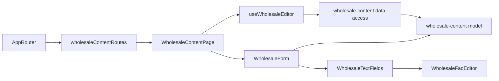

# Admin page «Співпраця»

**Status:** implemented. Route: `/wholesale-content` (menu «Сайт» → «Співпраця», all staff). Backend: KedrStore Content module, contract [page «Співпраця»](../../contracts/openapi/content/wholesale.openapi.yaml); the [site wholesale page](../site/wholesale.md) shows the saved texts.

- One form with tabs «Українська» and «Русский»; a tab with mistakes says «— є помилки». Both languages are saved together with «Зберегти».
- Sections follow the site page: «Перший екран» (title, lead, contact card title and note), «Асортимент» (title and intro), «Про компанію» (title after the company name, text, selection and warehouse blocks), «Як замовити» (section title and exactly three steps), «Питання оптових покупців» (title and 1–12 questions, moved up or down, added or removed; the last one cannot be removed), «Заклик унизу» (closing title).
- Every field is required; limits come from the backend (titles 120, short titles 80, short texts 200, texts 600, question 200, answer 1000 characters) and are checked before saving.
- Buttons, links, breadcrumbs, the company name, contacts and SEO metadata stay in code. The site shows a change within ten minutes (its cache life) and keeps its code texts while the API is unavailable.
- The form remembers unsaved changes against the loaded texts; after saving it shows «Тексти збережено. Сайт покаже їх протягом 10 хвилин.» and «Змінено: хто, коли».

## Architecture



## Code structure

```text
libs/admin/wholesale-content/
├── model/src/entities/wholesale-page.ts        # texts per language, field limits
├── model/src/forms/wholesale-draft.ts          # draft from the page, compare, move a question
├── model/src/validators/wholesale-rules.ts     # required fields, limits, at least one question
├── data-access/src/api/admin-wholesale-content.api.ts  # get and save the page
├── data-access/src/{contracts,validators,mappers}/
├── ui/src/forms/                                # form with language tabs, section fields
├── ui/src/faq/wholesale-faq-editor.tsx          # questions: move, add, remove
└── feature/src/                                 # wholesaleContentRoutes, page, editor hook, error messages
```

## Tests

- `npx nx run admin-wholesale-content-model:vite:test -- --run` — required fields, limits, question count.
- `npx nx run admin-wholesale-content-data-access:vite:test -- --run` — response mapping by language, trimmed request.
- `npx nx run admin-wholesale-content-ui:vite:test -- --run` — question editor.
- `npx nx run admin-wholesale-content-feature:vite:test -- --run` — load, edit, validation, save and its errors.
