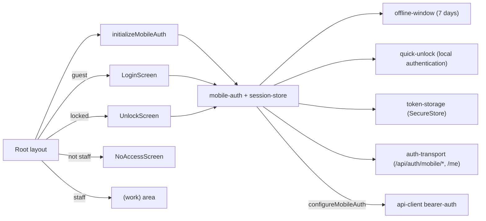

# Mobile sign-in and session

**Entry point:** [Root layout](../../../apps/mobile/src/app/_layout.tsx) starts `initializeMobileAuth()` behind the splash screen and splits routes with `Stack.Protected`: without a session only [login](../../../apps/mobile/src/app/login.tsx) exists; after sign-in the working area opens on customer choice. [SDD](../../specs/mobile/manager/001-manager-app/README.md) (R-001, R-014; SC-001, SC-002, SC-018, SC-019).

- Staff only: [LoginScreen](../../../libs/mobile/core/auth/src/screens/login-screen.tsx) («Офіс», show-password button) calls `POST /api/auth/mobile/login` with the Kedr Admin email and password. A signed-in account without the Admin or Manager role sees [NoAccessScreen](../../../libs/mobile/core/auth/src/screens/no-access-screen.tsx) with «Вийти» only.
- Tokens, the user and the time of the last server confirmation live only in the keychain/keystore through [token-storage](../../../libs/mobile/core/auth/src/storage/token-storage.ts) (`expo-secure-store`).
- [mobile-auth](../../../libs/mobile/core/auth/src/session/mobile-auth.ts) connects the shared API client; on a `401` [bearer-auth](../../../libs/mobile/shared/api-client/src/interceptors/bearer-auth.ts) refreshes the pair once and repeats the request. Every successful sign-in or refresh restarts the offline window. On start a session confirmed within the last seven days opens at once and is confirmed with the server in the background (a rejection signs out, new name or roles replace the saved ones), so a slow network never holds the splash screen; an older session must be confirmed first.
- Offline start: when the API cannot be reached, the saved session opens if the last confirmation is at most 7 days old ([offline-window](../../../libs/mobile/core/auth/src/session/offline-window.ts)); after that the login screen opens. KedrStore keeps `RefreshAbsoluteLifetimeDays` at 7 or more (KedrStore spec `platform/004`).
- Quick unlock: with «Швидкий вхід» on ([QuickUnlockRow](../../../libs/mobile/core/auth/src/components/quick-unlock-row.tsx) in the cabinet; turning it on asks for the fingerprint, face or device code once), a restored session starts `locked` and [UnlockScreen](../../../libs/mobile/core/auth/src/screens/unlock-screen.tsx) asks again ([quick-unlock](../../../libs/mobile/core/auth/src/session/quick-unlock.ts), `expo-local-authentication`). «Увійти паролем» signs out. A password sign-in never locks.
- Sign-out (`POST /api/auth/mobile/logout`) forgets the tokens and the saved session even offline; the [cabinet](cabinet.md) warns first when the send queue is not empty. Contract: [Session](../../contracts/identity/session.md).

## Structure diagram



## Code structure

```text
libs/mobile/core/auth/src/
├── components/
│   ├── auth-frame.tsx  # centered column for auth screens
│   └── quick-unlock-row.tsx  # cabinet switch
├── screens/
│   ├── login-screen.tsx  # email/password form
│   ├── login-error-message.ts  # 401/429/offline messages
│   ├── no-access-screen.tsx  # non-staff account
│   └── unlock-screen.tsx  # quick unlock of a saved session
├── session/
│   ├── auth-transport.ts  # mobile login/refresh/logout and me
│   ├── mobile-auth.ts  # login, logout, restore, offline start, unlock, single-flight refresh
│   ├── offline-window.ts  # 7-day rule
│   ├── quick-unlock.ts  # expo-local-authentication adapter
│   ├── quick-unlock-setting.ts  # setting hook
│   ├── session-store.ts  # loading/anonymous/locked/authenticated
│   ├── session-user.ts  # isStaff, isAdmin
│   └── use-mobile-session.ts  # React hook
└── storage/token-storage.ts  # SecureStore: tokens, saved session, quick unlock flag
```

## Tests

`libs/mobile/core/auth` (4 spec files: session, offline window, login, no access): `npx nx run mobile-core-auth:test`
