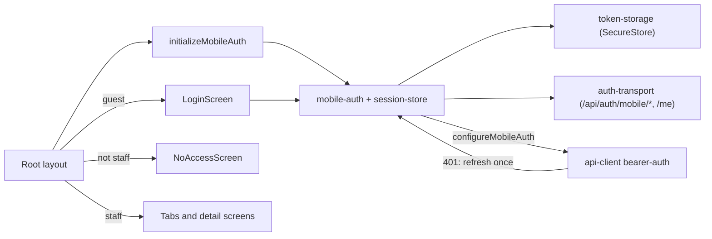

# Mobile sign-in

**Entry point:** [Root layout](../../../apps/mobile/src/app/_layout.tsx) starts `initializeMobileAuth()` behind the splash screen and splits routes with `Stack.Protected`: without a session only [login](../../../apps/mobile/src/app/login.tsx) exists; after sign-in the login screen disappears and the tabs open.

- The app uses the admin API, so it is for staff only. [LoginScreen](../../../libs/mobile/core/auth/src/screens/login-screen.tsx) calls `POST /api/auth/mobile/login`, which returns an access token (15 minutes) and a refresh token. A signed-in account without the Admin or Manager role sees [NoAccessScreen](../../../libs/mobile/core/auth/src/screens/no-access-screen.tsx).
- Both tokens live only in the device keychain/keystore through [token-storage](../../../libs/mobile/core/auth/src/storage/token-storage.ts) (`expo-secure-store`) and in memory; never in AsyncStorage, Redux, or logs.
- [mobile-auth](../../../libs/mobile/core/auth/src/session/mobile-auth.ts) connects the shared API client through `configureMobileAuth`. [bearer-auth](../../../libs/mobile/shared/api-client/src/interceptors/bearer-auth.ts) adds `Authorization: Bearer`; on a `401` it refreshes the pair once (`POST /api/auth/mobile/refresh`, parallel requests share one refresh) and repeats the request. If the refresh fails, the session ends and the login screen opens.
- On start a saved session is restored with `GET /api/auth/session/me`; an expired access token is refreshed first. Without a network the app asks to sign in and keeps the saved tokens.
- [AccountHeaderControl](../../../libs/mobile/core/auth/src/components/account-header-control.tsx) in the profile tab shows the name, email, and role and signs out (`POST /api/auth/mobile/logout`); the device forgets the tokens even when offline.
- Contract: [Session](../../contracts/identity/session.md).

## Structure diagram



## Code structure

```text
apps/mobile/src/app/
├── _layout.tsx  # session bootstrap and protected routes
└── login.tsx  # login route

libs/mobile/core/auth/src/
├── components/account-header-control.tsx  # user and sign-out
├── screens/
│   ├── login-screen.tsx  # email/password form
│   ├── login-error-message.ts  # 401/429/offline messages
│   └── no-access-screen.tsx  # non-staff account
├── session/
│   ├── auth-transport.ts  # mobile login/refresh/logout and me
│   ├── mobile-auth.ts  # login, logout, restore, single-flight refresh
│   ├── session-store.ts  # loading/anonymous/authenticated state
│   ├── session-user.ts  # isStaff
│   └── use-mobile-session.ts  # React hook
└── storage/token-storage.ts  # SecureStore

libs/mobile/shared/api-client/src/
├── auth/mobile-auth-adapter.ts  # adapter set by core auth
└── interceptors/bearer-auth.ts  # bearer header, refresh and retry
```

## Tests

- `libs/mobile/core/auth` (session and login screen): `npx nx run mobile-core-auth:test`
- `libs/mobile/shared/api-client` (bearer and refresh): `npx nx run api-client:test`
