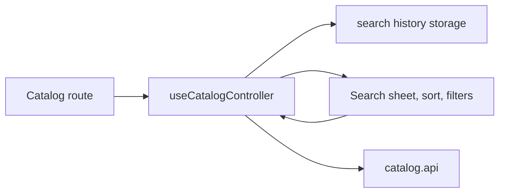

# Discovery UI Mobile

**Сценарій:** пошук, сортування й активні фільтри в [каталозі](catalog.md). [SDD](../../../specs/mobile/catalog/003-catalog-discovery-ui/README.md).

- [Catalog route](../../../../apps/mobile/src/app/%28tabs%29/catalog.tsx) передає дію пошуку до header. [useCatalogController](../../../../libs/mobile/catalog/feature/src/hooks/use-catalog-controller.ts) веде query, search history та пагінацію; [storage adapter](../../../../libs/mobile/catalog/feature/src/storage/catalog-search-history-storage.ts) зберігає історію локально.
- [Search sheet](../../../../libs/mobile/catalog/ui/src/components/query/catalog-search-sheet.tsx), [sort menu](../../../../libs/mobile/catalog/ui/src/components/query/catalog-sort-menu.tsx), [filters modal](../../../../libs/mobile/catalog/ui/src/components/query/catalog-filters-modal.tsx) та [active filters](../../../../libs/mobile/catalog/ui/src/components/query/catalog-active-filters.tsx) лише відображають і надсилають дії. Дані перезавантажує спільний [catalog.api](../../../../libs/mobile/catalog/data-access/src/api/catalog.api.ts).

## Схема будови



## Структура в коді

Фактичні точки входу й основні файли фічі (інші файли цих каталогів тут не перелічено):

```text
apps/mobile/src/app/
└── (tabs)/catalog.tsx  # точка входу маршруту

libs/mobile/catalog/
├── data-access/src/api/catalog.api.ts  # запит до API
├── feature/src/
│   ├── hooks/use-catalog-controller.ts  # стан і дії екрана
│   └── storage/catalog-search-history-storage.ts  # локальне збереження
└── ui/src/components/query/
    ├── catalog-active-filters.tsx  # компонент інтерфейсу
    ├── catalog-filters-modal.tsx  # компонент інтерфейсу
    ├── catalog-search-sheet.tsx  # компонент інтерфейсу
    └── catalog-sort-menu.tsx  # компонент інтерфейсу
```
