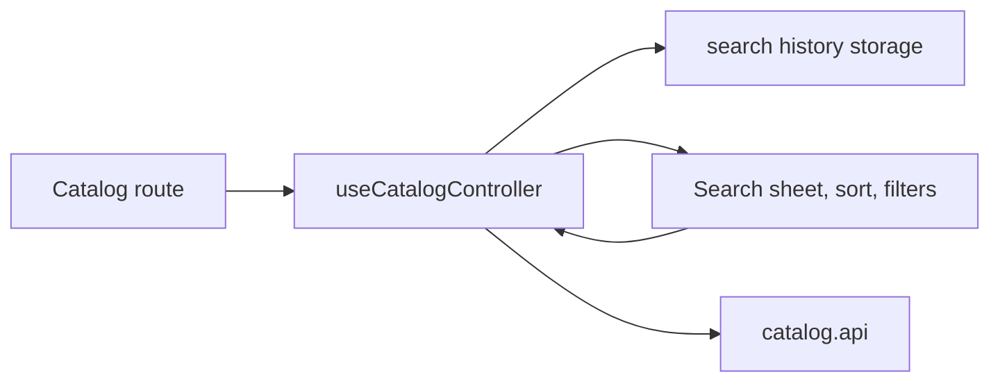

# Mobile Catalog Discovery UI

**Scenario:** search, sorting, and active filters in the [catalog](catalog.md). [SDD](../../../specs/mobile/catalog/003-catalog-discovery-ui/README.md).

- [Catalog route](../../../../apps/mobile/src/app/%28tabs%29/catalog.tsx) passes the search action to the header. [useCatalogController](../../../../libs/mobile/catalog/feature/src/hooks/use-catalog-controller.ts) manages the query, search history, and pagination; [storage adapter](../../../../libs/mobile/catalog/feature/src/storage/catalog-search-history-storage.ts) stores history locally.
- [Search sheet](../../../../libs/mobile/catalog/ui/src/components/query/catalog-search-sheet.tsx), [sort menu](../../../../libs/mobile/catalog/ui/src/components/query/catalog-sort-menu.tsx), [filters modal](../../../../libs/mobile/catalog/ui/src/components/query/catalog-filters-modal.tsx), and [active filters](../../../../libs/mobile/catalog/ui/src/components/query/catalog-active-filters.tsx) only render and dispatch actions. The shared [catalog.api](../../../../libs/mobile/catalog/data-access/src/api/catalog.api.ts) reloads the data.

## Architecture



## Code structure

Actual entry points and primary feature files (other files in these directories are omitted):

```text
apps/mobile/src/app/
└── (tabs)/catalog.tsx  # route entry point

libs/mobile/catalog/
├── data-access/src/api/catalog.api.ts  # API request
├── feature/src/
│   ├── hooks/use-catalog-controller.ts  # screen state and actions
│   └── storage/catalog-search-history-storage.ts  # local storage
└── ui/src/components/query/
    ├── catalog-active-filters.tsx  # UI component
    ├── catalog-filters-modal.tsx  # UI component
    ├── catalog-search-sheet.tsx  # UI component
    └── catalog-sort-menu.tsx  # UI component
```

## Tests

Spec files sit next to the code in each project. Focused runs:

- `apps/mobile` (5 spec files): `npx nx run mobile:test`
- `libs/mobile/catalog/data-access` (9 spec files): `npx nx run mobile-catalog-data-access:test`
- `libs/mobile/catalog/feature` (7 spec files): `npx nx run mobile-catalog-feature:test`
- `libs/mobile/catalog/model` (5 spec files): `npx nx run mobile-catalog-model:test`
- `libs/mobile/catalog/ui` (9 spec files): `npx nx run mobile-catalog-ui:test`
