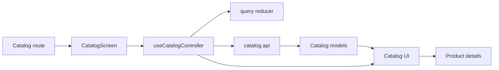

# Каталог Mobile

**Сценарій:** перелік товарів, категорії, пошук, фільтри, сортування й пагінація. [SDD](../../../specs/mobile/catalog/README.md).

- [(tabs)/catalog.tsx](../../../../apps/mobile/src/app/%28tabs%29/catalog.tsx) підключає [CatalogScreen](../../../../libs/mobile/catalog/feature/src/screens/catalog-screen.tsx) і навігацію до деталей.
- [useCatalogController](../../../../libs/mobile/catalog/feature/src/hooks/use-catalog-controller.ts) веде query reducer, сторінки й локальну історію пошуку; [UI](../../../../libs/mobile/catalog/ui/src/index.ts) відображає список. Окремі частини сценарію: [вибір категорії](category-filter.md) та [discovery UI](catalog-discovery.md).
- [catalog.api](../../../../libs/mobile/catalog/data-access/src/api/catalog.api.ts) і мапери перетворюють Admin Products/Categories API у [моделі](../../../../libs/mobile/catalog/model/src/index.ts). Контракти: [товари](../../../contracts/catalog/admin-products.md), [категорії](../../../contracts/catalog/admin-categories.md). Товар переходить до [деталей](product-details.md) і [кошика](../sales/cart.md).

## Схема будови



## Структура в коді

Фактичні точки входу й основні файли фічі (інші файли цих каталогів тут не перелічено):

```text
apps/mobile/src/app/
└── (tabs)/catalog.tsx  # точка входу маршруту

libs/mobile/catalog/
├── data-access/src/api/catalog.api.ts  # запит до API
├── feature/src/
│   ├── hooks/use-catalog-controller.ts  # стан і дії екрана
│   └── screens/catalog-screen.tsx  # екран фічі
├── model/src/index.ts  # публічний API бібліотеки
└── ui/src/index.ts  # публічний API бібліотеки
```
