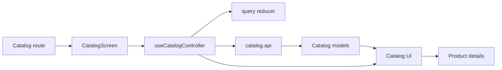

# Mobile Catalog

**Scenario:** product list, categories, search, filters, sorting, and pagination. [SDD](../../../specs/mobile/catalog/README.md).

- [(tabs)/catalog.tsx](../../../../apps/mobile/src/app/%28tabs%29/catalog.tsx) connects [CatalogScreen](../../../../libs/mobile/catalog/feature/src/screens/catalog-screen.tsx) and navigation to details.
- [useCatalogController](../../../../libs/mobile/catalog/feature/src/hooks/use-catalog-controller.ts) manages the query reducer, pages, and local search history; the [UI](../../../../libs/mobile/catalog/ui/src/index.ts) renders the list. Separate parts of the scenario: [category selection](category-filter.md) and [discovery UI](catalog-discovery.md).
- [catalog.api](../../../../libs/mobile/catalog/data-access/src/api/catalog.api.ts) and mappers transform the Admin Products/Categories API into [models](../../../../libs/mobile/catalog/model/src/index.ts). Contracts: [products](../../../contracts/catalog/admin-products.md), [categories](../../../contracts/catalog/admin-categories.md). A product opens [details](product-details.md) or the [cart](../sales/cart.md).

## Architecture



## Code structure

Actual entry points and primary feature files (other files in these directories are omitted):

```text
apps/mobile/src/app/
└── (tabs)/catalog.tsx  # route entry point

libs/mobile/catalog/
├── data-access/src/api/catalog.api.ts  # API request
├── feature/src/
│   ├── hooks/use-catalog-controller.ts  # screen state and actions
│   └── screens/catalog-screen.tsx  # feature screen
├── model/src/index.ts  # library public API
└── ui/src/index.ts  # library public API
```

## Tests

Spec files sit next to the code in each project. Focused runs:

- `apps/mobile` (5 spec files): `npx nx run mobile:test`
- `libs/mobile/catalog/data-access` (9 spec files): `npx nx run mobile-catalog-data-access:test`
- `libs/mobile/catalog/feature` (7 spec files): `npx nx run mobile-catalog-feature:test`
- `libs/mobile/catalog/model` (5 spec files): `npx nx run mobile-catalog-model:test`
- `libs/mobile/catalog/ui` (9 spec files): `npx nx run mobile-catalog-ui:test`
