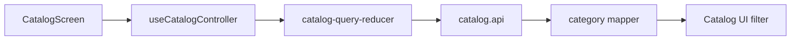

# Вибір категорії Mobile

**Сценарій:** звузити [каталог](catalog.md) до категорії. [SDD](../../../specs/mobile/catalog/002-category-filter/spec.md).

- [CatalogScreen](../../../../libs/mobile/catalog/feature/src/screens/catalog-screen.tsx) отримує дії з [useCatalogController](../../../../libs/mobile/catalog/feature/src/hooks/use-catalog-controller.ts); [catalog-query-reducer](../../../../libs/mobile/catalog/feature/src/state/catalog-query-reducer.ts) змінює query та повертає пагінацію на першу сторінку.
- [catalog.api](../../../../libs/mobile/catalog/data-access/src/api/catalog.api.ts) окремо читає категорії та товари, а [category mapper](../../../../libs/mobile/catalog/data-access/src/mappers/catalog-categories.mapper.ts) перевіряє transport data. UI фільтра — у [catalog UI](../../../../libs/mobile/catalog/ui/src/index.ts). [Контракт категорій](../../../contracts/catalog/admin-categories.md).

## Схема будови



## Структура в коді

Фактичні точки входу й основні файли фічі (інші файли цих каталогів тут не перелічено):

```text
libs/mobile/catalog/
├── data-access/src/
│   ├── api/catalog.api.ts  # запит до API
│   └── mappers/catalog-categories.mapper.ts  # перетворення відповіді API
├── feature/src/
│   ├── hooks/use-catalog-controller.ts  # стан і дії екрана
│   ├── screens/catalog-screen.tsx  # екран фічі
│   └── state/catalog-query-reducer.ts  # стан і взаємодія з даними
└── ui/src/index.ts  # публічний API бібліотеки
```
